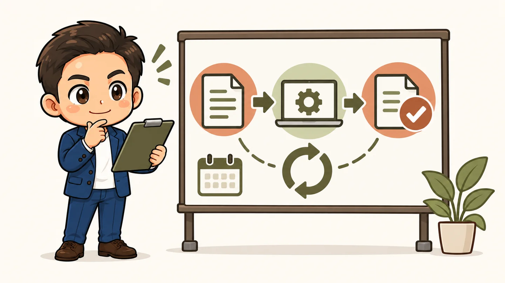

<!-- product-article-character-sheets: tamashiro-yusuke-business-casual-character-sheet-v3.png -->
<!-- product-article-character-check: hero-and-body-verified -->

「自分の仕事にAIを入れたいのですが、毎月いくらぐらいかかりますか？」

日々、AI導入の相談をいただく中で、よく聞かれるのが費用のことです。

私の答えは、**自分で使うところからなら月額数千円規模でも始められる。仕事の流れに組み込み、専門家の支援も受けるなら、そのための予算が別に必要になる**というものです。

同じAIを契約しても、使う人のスキルや、AIにどこまで任せたいかで総額は変わります。まずは、費用の中身を3つに分けて見ていきます。

## AI導入の費用は、3つに分けると分かりやすい

| 費用の種類 | 何にお金を払うのか |
| --- | --- |
| ツールの利用料 | AIサービスの契約、必要に応じたAPIや連携サービスの利用 |
| 初期の導入支援 | 業務の整理、設定、試作、使い方の共有 |
| 継続的な運用支援 | 困ったときの相談、動作確認、改善、変更への対応 |

「AIが月額いくらか」と「AIが仕事で使える状態になるまでに、いくらかかるか」は、分けて確かめる必要があります。

例えば、メールの下書きを自分でAIに頼むなら、ツールの利用料と、自分で試して覚える時間が中心です。一方、社内の資料を整理し、必要な情報を探し、決まった形式で書類を作る仕組みまで整えるなら、設計や確認の作業が増えます。

自分でできる部分が多いほど、外部へ依頼する範囲は小さくできます。ただし、自分で調べる時間や、うまく動かないときに直す時間もかかります。その分も見込んでおいてください。

## 月額数千円から、自分の仕事で試してみる

AIをまだあまり使っていない方は、最初から大きな仕組みを作る必要はありません。

メールの下書き、打ち合わせメモの整理、案内文の作成など、日々繰り返している仕事を一つ選んで試す。私は、この始め方で十分に便利さを体感できると考えています。

一例として、ChatGPT Plusの公式案内は月額20米ドルです。1ドル150円と仮定すると3,000円相当ですが、これは換算例で、実際の支払額は為替、税、契約経路などで変わります。契約するときの表示を見てください。[ChatGPT Plusの公式案内](https://help.openai.com/en/articles/6950777-what-is-chatgpt-plus)

上手な質問文を一つ覚えるだけでは足りません。AIとは、次のようなやり取りを重ねて使います。

- 何を作りたいのか、目的を伝える
- 相手や前提条件、必要な情報を渡す
- 出てきた内容を確かめ、違うところを直してもらう

このやり取りに慣れると、同じ契約でも使える場面が広がります。私は、**自分の仕事を順序立てて説明できることも、AIを使うスキルの一つ**だと思っています。

## 高いプランを選ぶ前に、何が足りないかを見る

使う回数が増えると、利用上限に届いて、必要なときに使えなくなることがあります。私もChatGPTを中心に、ClaudeやGoogleのGeminiを使っていて、どれだけ使うかと費用のつり合いは、いつも考えています。

現在はChatGPT Proの月額100米ドルのプランを主に使っています。ただ、私と同じ契約をすべての事業者に勧めたいわけではありません。まず、自分の仕事で何に困っているのかを見てほしいのです。

| 困っていること | 先に見直したいこと |
| --- | --- |
| 回答が期待と違う | 目的、前提、渡している資料、使うモデル |
| 利用上限で作業が止まる | 利用頻度、モデルごとの上限、プラン |
| 毎回コピーや転記が必要 | 仕事の手順や、既存ツールとの連携 |
| 社員が使い続けられない | 実際の業務に合う使い方、担当者、相談先 |

上位プランで解決しやすい問題もあれば、仕事の進め方を見直す必要がある問題もあります。

なお、2026年9月19日の公式案内では、ChatGPT Proには100米ドルと200米ドルの区分がありますが、200米ドルの区分の新規申込み・アップグレードは一時停止中です。利用上限や申込み条件は変わるため、プランを変えるときは、公式情報で最新の内容を見てください。[ChatGPT Proの公式案内](https://help.openai.com/en/articles/9793128-what-is-chatgpt-pro)

### 月額契約の上限と、APIの料金は分けて考える

AIの費用では「トークン」という言葉も出てきます。文章などをAIが処理するときの単位です。API（ほかのソフトからAIを呼び出して使うための窓口）を使った仕組みでは、モデルや処理量によって費用が変わります。

ChatGPTの月額プランとAPIは別の契約・課金です。Plusの公式案内でも、API利用料は含まれないと説明されています。[API課金についての公式説明](https://help.openai.com/en/articles/6950777-what-is-chatgpt-plus)

そのため、「AIをたくさん使うと支出が増える」という話と、「AIの単価そのものが一律に上がっている」という話は、分けて考えます。予算を立てるときは、月額料金に加えて、連携に追加料金がかかるか、使う量が増えたときに費用がどう変わるかも調べておいてください。

## AI秘書を仕事に組み込むなら、設計と運用にも予算を

ここでいうAI秘書は、日々の情報整理や書類作成などを、自分の仕事の手順に合わせて手伝ってもらう仕組みです。

そのためには、どの資料を使うか、どんな形で書き出すか、誰が中身を見るかを決めておきます。専門家の支援を受けるなら、その整理や設定、試しながら直す作業に費用がかかります。

予算を考えるための仮の例として、**初期導入に20万〜30万円、導入後はツール代と支援費を合わせて月5万〜6万円程度**を置いてみます。ただし、これは私が想定する一例で、一般的な相場やT&Lサポートの正式な料金を示すものではありません。

対象業務の数、資料の整理状況、連携するシステム、支援期間によって必要な費用は変わります。小さな範囲ならもっと絞れますし、独自開発や複雑な連携が必要なら、この予算では収まらないこともあります。

見積りを取るときは、金額に加えて次のことを確かめておくと、比べやすくなります。

- 初期費用で、何ができる状態まで作るのか
- 月額費用に、相談や修正がどこまで含まれるのか
- ツール代、人数分の契約、API利用料は別か
- 担当者が変わったとき、手順を引き継げるか
- 支援が終わっても、会社側で使い続けられるか

AIは、設定して終わりではありません。資料や担当者が変わったり、思った答えが出なくなったりしたときに、誰が見直すかまで決めておくと、毎日の仕事で使い続けやすくなります。

## すでに使っているGoogleやMicrosoftから考える

AIを導入するために、仕事の道具をすべて入れ替える必要はありません。

Google Workspaceを使っている会社なら、まず契約中のプランに含まれるGeminiの機能を確かめる。Microsoft 365を使っている会社なら、今の契約で使えるCopilotの範囲と、追加契約が必要な機能を調べる。この順番が現実的だと私は考えています。

Google WorkspaceではプランごとのAI機能が公式の比較表に載っています。機能や利用条件を見てから、別のAIサービスを足すかどうかを決めてください。[Google Workspaceのプラン比較](https://workspace.google.com/pricing?hl=ja)

「どの会社のAIが一番か」より先に、**普段のメールや書類がどこにあり、誰が使うのか**を見る。そこから選ぶと、入れたあとの使い方も考えやすくなります。

## AIが広がるほど、作った先で何をするかが大切になる

私は、AIが広く使われるようになると、文章や画像を作る作業だけを請け負う仕事は、今まで以上に、値段や速さで比べられやすくなると考えています。

ただ、資料ができても、それだけでお客様の悩みが解決するとは限りません。誰に届けて、相手にどう動いてもらうのか。数字を見て、次に何を変えるのか。そこまで一緒に考えられるかどうかが、これからもっと問われると思います。

AIを学ぶのは、操作を覚えるためだけではありません。自分の仕事を整理し、お客様の困りごとを分かったうえで、改善につなげる。その経験を積むためなら、今お金と時間を使う価値があると思っています。

## 最初の1か月は、一つの仕事で効果を確かめる

これから始める方に私が勧めたいのは、毎週繰り返している仕事を一つ選び、1か月試してみることです。

1. メールの下書きや打ち合わせメモなど、対象を一つ決める
2. 今かかっている時間を記録する
3. AIを使い、見直しや修正も含めた時間を測る
4. 1か月後に、費用と効果を比べて続け方を決める

例えば、1日15分の作業を20日分減らせたら、月5時間です。これは計算例ですが、その時間をお客様への対応や、本来やりたかった仕事に回せるなら、費用をかける理由が見えてきます。ただ、短くなった時間がそのまま売上になるわけではありません。空いた時間を何に使うかまで決めておきます。

最初は、AIに入力してよい情報の範囲を確かめたうえで、人が中身を見直してから使える仕事を選んでください。うまくいかなければ元の手順に戻せる、小さな範囲で十分です。

私は、AIにかける費用を、自分の仕事をより良くするための投資と考えています。だからこそ、「いくらのプランにするか」と一緒に、「どの仕事を、どれだけ楽にしたいか」を具体的にしていきたいのです。

AIを入れようか考えている方は、まず毎日の仕事で時間がかかっていることを一つ、書き出してみてください。それが、自分で試すところと、人に手伝ってもらうところを分ける手がかりになります。

*サービス情報の確認日：2026年9月19日。料金・利用上限・提供条件は変更される場合があります。*
