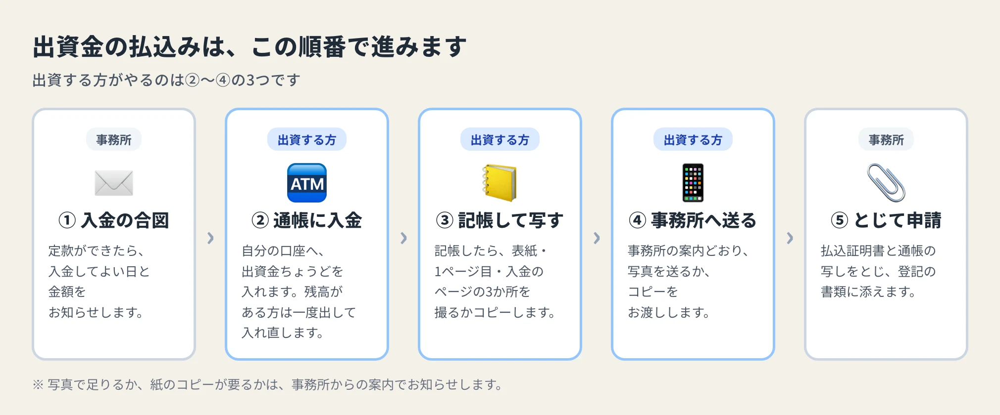
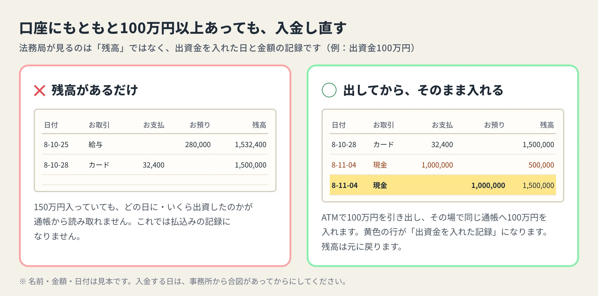
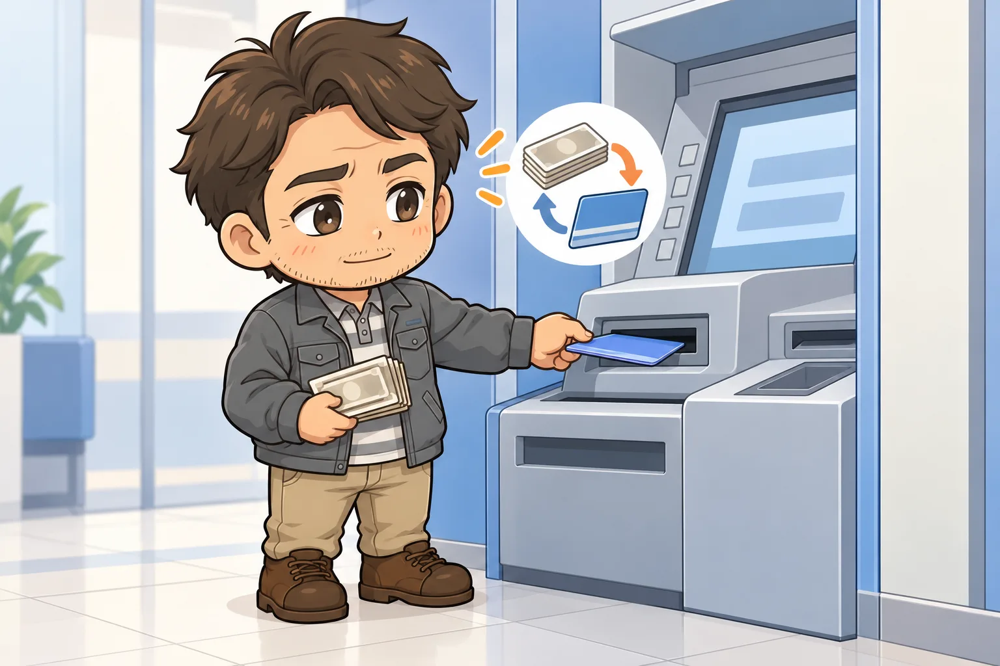
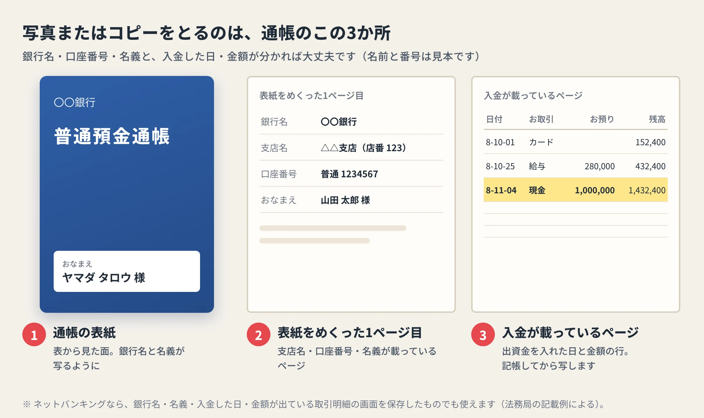
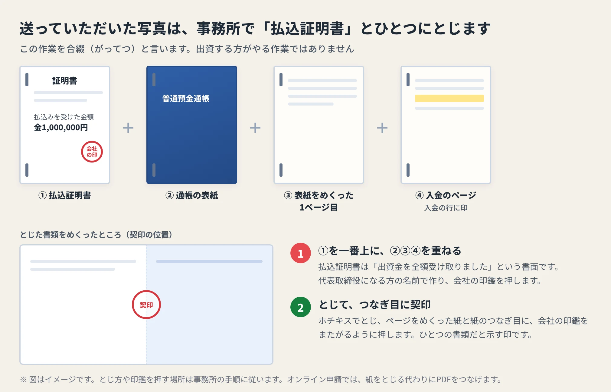

<!-- product-article-character-sheets: tamashiro-yusuke-character-sheet-v5.png, tl-four-character-style-master-v2.png, worried-business-owner-character-sheet-v1.png, accounting-staff-character-sheet-v1.png -->
<!-- product-article-character-check: hero-and-body-verified -->

会社をつくる手続きの途中で、司法書士事務所から「出資金を通帳に入れて、写しを送ってください」とお願いされることがあります。

お願いされた方は、たいてい戸惑います。お金はもう口座にあるのに、また入れるのか。どのページを写せばいいのか、スマホの写真でもいいのか。

会社設立の手続きの中でも、ここはお客さまへの説明がとても難しいところです。お金を動かす話なので、口で一度聞いただけでは頭に入りにくいからです。

この記事では、法務省と法務局の公式の資料を確かめたうえで、出資する方が自分で準備を始められるように、順番と通帳の写し方を図にまとめました。

## 先に結論。出資する方がやることは3つ

出資金とは、会社の元手として出すお金のことです。払込みとは、その出資金を口座に入れて、入れた記録を残すことを言います。

出資する方にお願いするのは、次の3つです。

1. 事務所から合図が来たら、自分の口座に出資金ちょうどを入れる
2. 通帳を記帳して、表紙・表紙をめくった1ページ目・入金が載ったページの3か所を写す
3. 写真かコピーを事務所へ渡す

そのあとの、書類をとじて法務局へ出す作業は事務所が受け持ちます。

## なぜ通帳の写しが要るのか

会社の設立登記（法務局に会社を登録する手続き）では、出資金が本当に払い込まれたことを書面で示します。法務局の記載例では、代表取締役になる人が作る「全額の払込みを受けました」という証明書に、預金通帳の写しを合わせてとじたものを、その書面として挙げています。

通帳の写しは、「この日に、この金額が入った」という証拠になります。会社の口座は会社ができてからでないと作れないため、設立前は出資する方の個人の口座を使います。

## 手順1 どの口座に入れるかを決める

入れる先は、出資する人の個人名義の口座が基本です。登記の言葉では、会社をつくるために出資する人を「発起人（ほっきにん）」と呼びます。

ひとりで出資して、自分が代表取締役になる会社なら、迷うところはありません。自分の口座に入れます。いま使っている口座で手続きできます。

出資する人と、代表取締役になる人が別のときは注意が要ります。代表取締役になる人の口座に入れることもできますが、その場合は、出資する人から「お金の受け取りを任せます」という委任状が必要です（法務省の案内による）。

出資する人が2人以上いるときも、誰の口座に、誰がいくら入れるかで準備が変わります。入金する前に、事務所と決めておいてください。

## 手順2 合図が来てから、出資金ちょうどを入れる

入れる金額は、出資すると決めた金額の全額です。出資金が100万円なら、100万円ちょうどを入れます。

入れるのは、事務所から合図があってからにしてください。払込みは、定款（会社の名前や目的などの決まりを書いたもの）ができたあとに行う順番になっています。早く入れてしまうと、入れ直しをお願いすることがあります。

ATMで現金を入れても、ほかの口座から振り込んでもかまいません。

### もともと残高があるときは、一度出して入れ直す

ここが、いちばん分かりにくいところです。口座に100万円以上入っていても、そのままでは払込みの記録になりません。

法務局が見るのは、通帳の「残高」ではありません。出資金を入れた日と金額が載った1行です。法務局の記載例でも、通帳の写しの入金や振込の部分に印を付けて、払い込んだ日と金額が分かるようにすることになっています。

残高が150万円あっても、そのうちどれが出資金なのかは、通帳からは読み取れません。そこで、ATMで100万円を一度引き出し、その場で同じ通帳へ100万円を入れます。残高は元に戻り、通帳には100万円を入れた行が残ります。

入れたお金は、写しを事務所に渡し終えるまで動かさないでください。

## 手順3 記帳して、通帳の3か所を写す

入金したら、ATMか窓口で通帳を記帳します。入金の行が印字されたのを見てから写してください。

写すのは、次の3か所です。

1. 通帳の表紙
2. 表紙をめくった1ページ目（銀行名・支店名・口座番号・名義が載っているページ）
3. 出資金の入金が載っているページ

法務局の記載例では、通帳の写しに「口座の名義人が分かる部分」を含めることになっています。1と2は、誰のどの口座かを示すため、3は払込みの証拠です。

通帳のないネット銀行やネットバンキングの口座でも手続きできます。その場合は、取引明細の画面を印刷または保存したものを使います。銀行名、口座の名義、入金した日、金額の4つが載っていることが条件です（法務局の記載例による）。

### スマホで写真を送るときのコツ

紙のコピーでなく、スマホの写真を送るだけで足りる場合もあります。どちらが必要かは、手続きの状況によって変わるので、事務所の案内に合わせてください。

写真で送るときは、次のように撮ると、事務所で何度も撮り直しをお願いせずにすみます。

- 通帳を平らに開き、真上から撮る
- ページの四隅まで写す
- 明るい場所で撮り、影や光の反射が文字にかからないようにする
- 撮ったら拡大して、口座番号と入金の金額が読めるかを見る

3か所がそろったら、事務所が案内する方法で送ってください。

## 手順4 事務所で、払込証明書とひとつにとじる

出資する方の作業は、ここまでです。この先は事務所で進めます。

事務所では、前もって「払込証明書」を用意しています。代表取締役になる方の名前で、出資金を全額受け取ったことを書いた書面です。ここには会社の印鑑（法務局に届け出る会社の実印）を押していただきます。押していただく時期は、事務所からお知らせします。

この払込証明書を一番上にして、通帳の写し3枚を重ねてとじます。この作業を合綴（がってつ）と言います。入金の行にはマーカーか下線を引き、紙と紙のつなぎ目には会社の印鑑をまたがるように押します。この印を契印（けいいん）と言い、とじた紙がひとつの書類だと示すためのものです。

インターネットで登記を申請する場合は、紙をとじる代わりに、通帳の写しをPDFにして証明書とつなげます。

## よくある疑問

### 会社の口座を先に作っておく必要はありますか

ありません。会社の口座は、登記が終わって会社ができてから作ります。設立前の払込みには、出資する方の個人の口座を使います。

### 入れたお金は、いつから使えますか

通帳の写しを事務所に渡し終えるまでは、そのままにしておきます。会社ができたあとのお金の移し方は、事務所や顧問の税理士に聞いてください。

### 合同会社でも同じですか

考え方は同じです。合同会社では、証明書を作るのが代表取締役でなく代表社員（合同会社を代表する人）になります。通帳の写しを合わせてとじ、振込の部分に印を付ける点も、法務局の記載例で同じように案内されています。

## 迷ったら、入金する前に聞く

出資金の払込みは、一度入金してしまうと、やり直しに手間がかかります。金額、入れる口座、入れる日の3つは、入金する前に事務所と確かめておいてください。

手続きの細かいところは、会社の形や出資する人の数によって変わります。この記事で全体の流れをつかんだうえで、最後は依頼している司法書士事務所の案内に従ってください。

### 参考にした公式の資料

- [商業・法人登記の申請書様式（株式会社設立登記申請書・合同会社設立登記申請書の記載例）｜法務局](https://houmukyoku.moj.go.jp/homu/COMMERCE_11-1.html)
- [株式会社の設立手続（発起設立）について｜法務省](https://www.moj.go.jp/MINJI/minji06_00134.html)
- [外国人・海外居住者の方の商業・法人登記の手続について（預金通帳の口座名義人の範囲）｜法務省](https://www.moj.go.jp/MINJI/minji06_00104.html)
- [会社法第34条第1項の規定による払込みがあったことを証する書面について（通達）｜法務省](https://www.moj.go.jp/content/001384992.pdf)

*情報の確認日：2026年10月22日。手続きの細かい扱いは、管轄の法務局や依頼する事務所によって異なる場合があります。*
