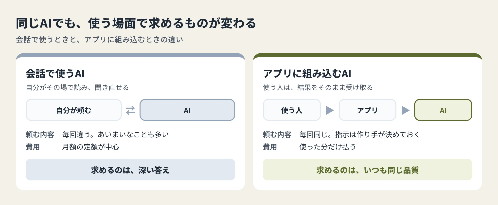
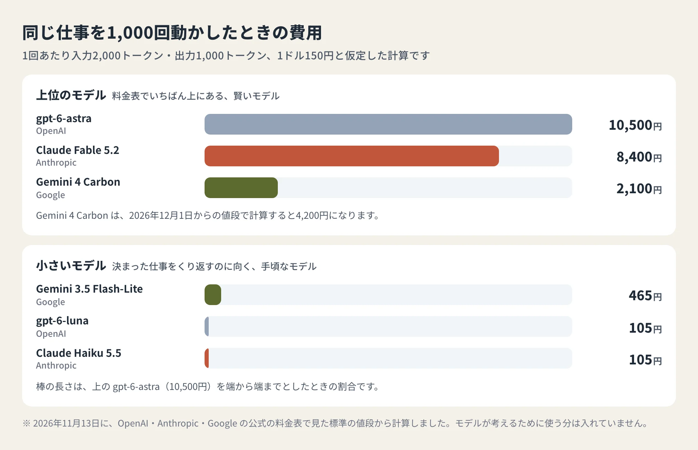
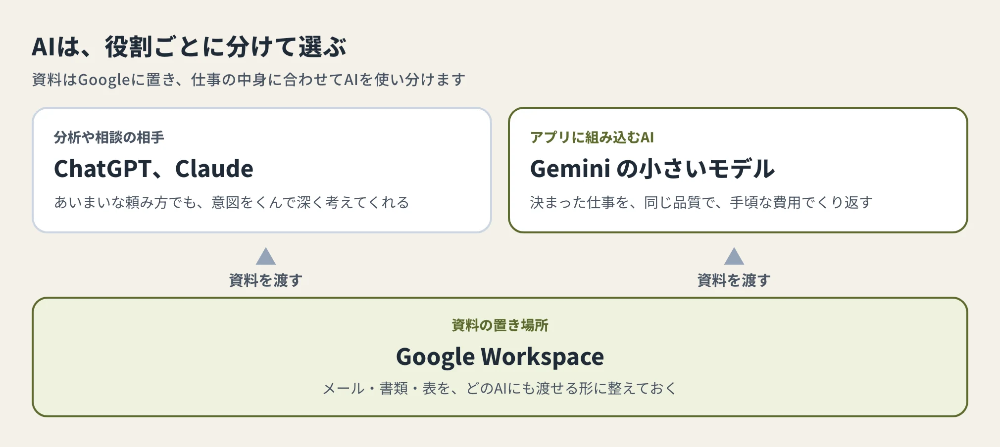

<!-- product-article-character-sheets: tamashiro-yusuke-character-sheet-v5.png, tl-four-character-style-master-v2.png, tamashiro-yusuke-business-casual-character-sheet-v3.png, rira-character-sheet-v3.png -->
<!-- product-article-character-check: hero-and-body-verified -->

「Geminiより、ChatGPTやClaudeを仕事で使いたい」

私の会社で、この声が増えています。Google Workspace（Gmailやドライブがまとまった、Googleの仕事用サービス）を使っているので、AIもこれまではGeminiが中心でした。

その気持ちは、私もよく分かります。経営の分析や相談ごとでは、ChatGPTやClaudeのほうが、的を射た答えを返してくれる場面が多いからです。こちらの頼み方があいまいでも、意図をくんで形にしてくれます。Geminiは、同じ頼み方だと外れた答えが返ってくることがあります。

ところが、Webアプリを作る立場になると、見え方が変わりました。**人が会話で使うAIは賢さで選び、アプリに組み込むAIは「同じ品質で、手頃な費用で、動き続けること」で選ぶ**。この基準で見ると、私にはGeminiのAPIがちょうどよく思えます。

料金の話を思い込みで書きたくなかったので、3社の公式の料金表を見比べました。調べる前の予想と違っていたところも、そのまま書きます。

## 会話で使うAIと、アプリに組み込むAIは、求めるものが違う

API（ほかのソフトからAIを呼び出すための窓口）を使うと、自分で作ったアプリの中でAIを働かせられます。相談のメモを決まった形の報告書にまとめる、問い合わせの文を種類ごとに分ける、といった仕事です。

同じAIでも、会話で使うときとは条件がずいぶん違います。

会話では、答えを読んで「ここは違う」と言い直せます。アプリの中では、それができません。使う人は出てきた結果をそのまま受け取るので、100回動かして100回とも同じ出来で返ってくることが、何より大事になります。

指示の文も、渡す情報も、作り手があらかじめ決めておけます。あいまいな頼み方を読み解く力は、会話のときほどは要りません。料金表でいちばん上にある賢いモデル（AIの種類）を使わなくても、足りる仕事が多いのです。

## 3社の公式の料金表を見比べる

APIの料金は、トークン（AIが文章を処理するときの単位）の量で決まります。AIに渡す文が「入力」、返ってくる文が「出力」で、それぞれ100万トークンあたりの値段が決められています。

2026年11月13日に、各社の公式ページで見た値段です。

| 会社 | 上位のモデル（入力／出力） | 小さいモデル（入力／出力） |
| --- | --- | --- |
| OpenAI（ChatGPTの会社） | gpt-6-astra：10ドル／50ドル | gpt-6-luna：0.10ドル／0.50ドル |
| Anthropic（Claudeの会社） | Claude Fable 5.2：8ドル／40ドル | Claude Haiku 5.5：0.10ドル／0.50ドル |
| Google | Gemini 4 Carbon：2ドル／10ドル | Gemini 3.5 Flash-Lite：0.30ドル／2.50ドル |

Claude Haiku 5.5は、一度に渡す量が10万トークンまでのときの値段です。Gemini 4 Carbonは、2026年12月1日から4ドル／20ドルに上がります。

数字だけでは分かりにくいので、仕事に置きかえます。相談のメモを1件渡して、要点を数段落で返してもらう処理を「入力2,000トークン、出力1,000トークン」と置き、1,000回動かしたときの費用を出しました。1ドル150円と仮定した計算です。

調べる前の私は、「ChatGPTやClaudeのAPIは賢いけれど高い。安く作るならGemini」と考えていました。料金表を見ると、合っていたのは半分でした。

上位のモデルどうしで比べると、Geminiは他の2社の4分の1から5分の1です。12月に値上げされたあとも、半分以下に収まります。一方、小さいモデルでは、OpenAIとAnthropicのほうがGeminiより安くなっていました。値段を分けていたのは、会社の違いよりも、モデルの大きさです。OpenAIでは、上位のモデルと小さいモデルで100倍の差があります。

どの会社でも、小さいモデルを選べば、1,000回動かして数百円までに収まります。アプリに組み込むAIの費用は、「どの会社にするか」より先に「どの大きさのモデルで足りるか」で決まる。これが、料金表を見ていちばん考えが変わったところです。

なお、Geminiの料金表には、モデルが考えるために使った分も出力に数えると書かれています。実際の請求は、この計算より増えることがあります。

### 「安く作るなら中国の会社のAI」も調べた

費用を抑えるなら中国の会社のAI、という話もよく聞きます。

DeepSeekの公式の料金表では、小さいモデルのdeepseek-flashが、入力0.15〜0.30ドル、出力0.60〜1.20ドルでした。時間帯によって値段が変わります。先ほどと同じ計算をすると1,000回で135〜270円になり、アメリカの3社の小さいモデルと大きな差はありません。

お客様の情報を扱う道具では、データをどの国のどの会社に預けるかも、選ぶ理由になります。値段の差がこれだけ小さいので、私は候補に入れていません。

## それでも私がGeminiのAPIを選ぶ理由

値段だけなら、gpt-6-lunaやClaude Haiku 5.5のほうが安い。それでも私は、自分の道具にはGeminiが合うと考えています。

### 無料の枠で、何度でも試せる

Gemini 3.5 Flash-Liteと、その上のGemini 3.8 Flash、Gemini 4 Hydrogenには、無料で使える枠があります。

新しい道具を作るときは、指示の文を何十回も書き直します。うまくいくか分からない段階で費用を気にせずに試せるのは、作る側にとって助かります。

ただし料金表には、無料の枠で送った内容はGoogleの製品をよくするために使われる、とあります。お客様の情報を入れる段階になったら、有料の枠に切りかえてください。有料の枠で送った内容は、この目的には使われません。

### 資料が、すでにGoogleの中にある

Google Workspaceを使っている会社は、メールも書類も表も、Googleの中にあります。

AIを組み込んだ道具の出来は、AIの賢さよりも、何をどう渡すかで決まることが多いと私は感じています。渡す材料がGoogleの中にそろっているなら、AIも同じGoogleのものにしておくと、つなぐ仕組みを作りやすくなります。

### 日本語の読みやすさと、上位のモデルの値段

日本語の読みやすさも、理由の一つです。案内文や要約を書かせたときの日本語が、Geminiは自然だと私は感じています。数字で測った結果はなく、私の使用感です。

小さいモデルで足りない仕事が出てきたときも、替える先の上位のモデルが、先ほどの表のとおり他の2社より安く済みます。

## 料金は動く。モデルを差しかえられる作りにしておく

今回の料金表で気になったのは、値上げの予定です。

Gemini 3.8 Flashは、2026年12月31日までは入力0.75ドル／出力3.75ドルで、2027年1月1日から1.50ドル／7.50ドルになります。Gemini 4 Carbonも、12月1日から2倍です。いま手頃なモデルが、来年も手頃とは限りません。

道具を作るときに、次のことを先に決めておくと、値段が変わっても慌てずに済みます。

- AIを呼び出す部分を1か所にまとめ、モデルの名前を設定で替えられるようにする
- 月に使ってよい金額の上限を決め、近づいたら知らせが届くようにする
- 同じ入力の見本を10件ほど残し、モデルを替えたら出力を見比べる

最後の一つは、品質をそろえるための備えです。モデルを替えたあとの「前より雑になった」に、使う人からの連絡で気づくのでは遅い。作り手の側で先に見ておきます。

## AIエージェントでは、Googleは追いかける側に見える

2026年は、エージェント（頼んだ仕事を、AIが自分で手順を考えて進める仕組み）を各社が出した年でした。

- 6月：Metaが、店や会社がWhatsAppやMessengerで使う「Business Agent」を発表（[ロイターの記事](https://www.thestar.com.my/tech/tech-news/2026/06/03/meta-enters-enterprise-ai-race-with-new-business-agent)）
- 8月：SpaceXAI（イーロン・マスク氏のAIの会社。以前の名前はxAI）が、AIがチームのように働く「Grok Bot」を発表（[ブルームバーグの記事](https://www.thestar.com.my/tech/tech-news/2026/08/12/spacexai-unveils-grok-bot-to-work-like-a-team-of-ai-agents)）
- 10月：Googleが、仕事用の「Geminiエージェント」を発表。まず企業向けに出し、個人向けはそのあとになる（[TechCrunchの記事](https://techcrunch.com/2026/10/08/google-brings-agentic-ai-to-gemini-starting-with-businesses/)）

私の目には、会話とエージェントの分野はChatGPTとClaudeが前を走り、SpaceXAIやMetaも力を入れていて、Googleは追いかける側に見えます。

私が注目したのは、GoogleのGeminiエージェントが、他社のAIも選べる作りになっていることです。最初の相手は、AnthropicのClaudeだと報じられています。Google自身が、Geminiだけで済ませずに、ほかのAIとつないで使う方向を示したと私は受け取りました。

Geminiの使い方も、考え直す時期だと思います。会話もエージェントも、すべてをGeminiに求めるのはやめます。Googleには資料の置き場所とアプリの裏方を任せ、深く考える仕事はChatGPTやClaudeに回す。そのために、Googleの中にある資料を、ほかのAIにも渡せる形に整えていきます。

## 役割を分けると、選びやすくなる

私の使い分けは、次の形に落ち着きました。

「Geminiは弱い」という評判は、会話の相手として比べたときの話です。アプリの裏方として見ると、無料で試せて、資料のそばにいて、上位のモデルも手頃なGeminiには、選ぶ理由がいくつもあります。

自分の道具にAIを組み込もうとしている方は、1回の処理で渡す文の量と、月に動かす回数を書き出してみてください。この2つが分かれば、料金表から月の費用を計算できます。

## 公式の料金表

- [Gemini APIの料金（Google）](https://aistudio.google.com/docs/pricing)
- [OpenAI APIの料金](https://developers.openai.com/api/docs/pricing)
- [Claude APIの料金（Anthropic）](https://platform.claude.com/docs/en/about-claude/pricing)
- [DeepSeek APIの料金](https://api-docs.deepseek.com/quick_start/pricing)

*料金とサービス情報を見た日：2026年11月13日。料金・無料の枠・提供の条件は変わることがあります。使う前に、公式ページで最新の内容を見てください。*
