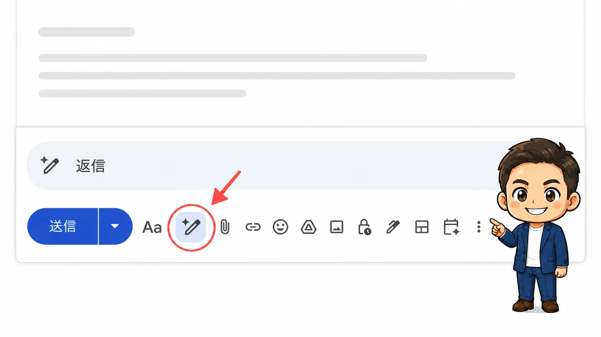

<!-- product-article-character-sheets: tamashiro-yusuke-business-casual-character-sheet-v3.png -->
<!-- product-article-character-check: hero-and-body-verified -->

お客様から届いた問い合わせメールを開き、「どう返そうか」と手が止まる。

メールの内容は分かっていても、失礼のない書き出し、伝える順番、言い回しを考えているうちに時間が過ぎていきます。特にクレームや確認事項の多いメールは、返信を始めるまでが重い仕事でした。

Google Workspaceを使うようになって、私が最初に大きな変化を感じたのが、このメール作成と返信です。

**Gmailの中でGeminiに下書きを頼めるようになり、「最初の一文を書く」というハードルが大きく下がりました。**

しかも、返信前にメールを要約したり、伝えたい要件を整理したりする必要はありません。受信メールの返信欄でGeminiを開き、まず「返信」と入れて下書きを出す。私が便利だと感じているのは、この手間の少なさです。

## 一番の変化は、AIが送信することではなく、下書きから始められること

Geminiが作った文章を、そのまま一発で送れるとは限りません。宛先、日付、金額、約束する内容、添付ファイルは、自分で確認する必要があります。

それでも、白紙の状態から考え始めるのと、たたき台を読んで直すのとでは、負担がまったく違います。

私にとっての生産性向上は、文字を打つ速度が上がったことではありません。**「どう書き始めよう」と悩む時間が減り、確認と判断に集中できるようになったこと**です。

AIを使う前の準備も、できる限り増やしたくありません。クリックや入力、画面の切り替えを一つ減らすだけでも、毎日の仕事では効いてきます。

## 以前は、メールを別のAIへ運ぶ作業が必要だった

これまでも、AIにメールの下書きを作ってもらうことはできました。ただ、実際には次の作業が必要になります。

1. Gmailで受信メールを開く
2. 本文をコピーする
3. 別のAIツールを開いて貼り付ける
4. 相手との関係や、これまでの経緯を説明する
5. AIが作った文章をGmailへ戻す
6. 内容を確認して送信する

一つひとつは小さな操作ですが、毎日何通も重なると無視できません。画面を行き来するたびに、何を伝えたかったのかも頭の中で組み直す必要があります。

GmailのGeminiなら、メールを開いたその場で下書きを作れます。Googleの公式ヘルプでも、Gmailの「Help me write」で新規メールや返信の下書きを作り、今ある文面をフォーマルにする、短くする、内容を追加するといった調整ができると案内されています。

特に返信では、Geminiがスレッド内の過去のメッセージを踏まえて、会話に沿った下書きを作れます。こちらが毎回、メールの経緯をコピーして説明し直す必要はありません。

## 返信は、まず「返信」だけで下書きを出す

正直、AIへ指示するためにメールを要約したり、返信の要件を整理したりすること自体が面倒です。

AIを使うための下準備が新しい仕事になってしまえば、手間を減らしきれません。私が最初に求めるのは、完璧な文章よりも、**返信のたたき台がすぐに出ること**です。

### 1. 受信メールの返信欄を開く

まず、届いたメールの返信欄を開きます。この時点で、Gmailには相手のメールと、それまでのやり取りがそろっています。

本文をコピーして別のAIへ移す必要はありません。返信前に、自分でスレッドを要約する必要もありません。

### 2. Geminiのボタンを押し、「返信」と入れる

返信欄にあるGeminiのボタンを押し、私はまず、これだけ入力します。

> 返信

私の環境では、これでGeminiがメールのやり取りを踏まえた返信の下書きを作ります。

Googleの公式情報でも、「Help me write」はメールスレッド内の過去のメッセージの文脈を理解し、会話に関連する返信下書きを作ると説明されています。

利用環境によっては、開いているメールで「このメールへの返信を提案」を選ぶボタンや、スレッド全体を考慮した返信候補が表示される場合もあります。そのボタンが使えるなら、文字を入力する操作さえ減らせます。

### 3. 必要な修正だけ、後から指示する

まず出てきた下書きを読みます。そのまま使えそうなら、事実関係を見直して送ります。

不足があるときだけ、「金曜日までに一次回答すると入れて」「もう少しやわらかく」「短くして」と追加します。

2026年6月のGoogle公式アップデートでは、最初の下書きに対し、「2行目へ不足情報を加える」「期限を入れる」といった追加指示で文面を更新できる機能も案内されています。

大事なのは、最初から詳しい指示文を作ろうとしないことです。**まず下書きを出し、その下書きに足りない部分だけを直す。**この順番が、いちばん手数を減らせる使い方だと感じています。

## 新規メールは、最低限だけ伝えて下書きを出す

返信メールには、すでに相手とのやり取りがあります。新規メールには手がかりになる過去のメールがないので、目的だけは短く伝えます。

たとえば、長い依頼文を考える必要はありません。

> 昨日の相談のお礼。来週火曜日までに次の進め方を連絡。

まず下書きを出してから、必要な内容を追加します。新規メールでも、指示文をきれいに書くことには時間を使いません。

## 過去のメールとDriveに情報があるほど、下書きは実務に近づく

Gmail内でGeminiを使うよさは、文章を作れることだけではありません。

Googleの公式ヘルプでは、「Help me write」が他のメールやDriveファイルから関連情報を取り込み、下書きを相手や用件に合わせて調整できると説明されています。参照したメールや文書は「Sources」で見られます。

たとえば、過去のメールに打ち合わせの経緯があり、Driveに見積書や議事録が整理されていれば、必要になったときにGeminiに情報を探してもらえます。

だから私は、Google Workspaceを単なるメールとファイル保存のセットではなく、**会社の仕事の経緯を、必要な権限の中でAIが参照しやすくする基盤**だと考えています。

ただし、資料名がばらばらで、古いファイルと最新のファイルが混ざっていれば、AIも正しい情報を選びにくくなります。GmailでGeminiを使うのと並行して、Driveのフォルダ、ファイル名、共有権限も整えておくことが大切です。

## 最後の確認は、必ず人が行う

AIが作るのは、あくまで下書きです。Googleの公式ヘルプにも、Geminiは不正確な内容を生成する場合があるため、提案内容を確認するよう注意書きがあります。

私は、送信前に最低でも次の項目を確認します。

- 宛先と相手の名前は合っているか
- 日付、曜日、時刻は合っているか
- 金額や数量に間違いはないか
- 約束していないことを断定していないか
- 添付すると書いたファイルが付いているか
- 相手との関係に合った言葉遣いか

特にクレーム対応では、きれいな文章を作ることより、事実関係と対応方針を間違えないことが優先です。

## 中小企業は、まず1通の返信から試せばよい

Google Workspaceを導入したからといって、最初から社内のすべての仕事をAI化する必要はありません。

まずは、毎日届くメールを1通選び、次の順番で試すのがよいと思います。

1. 受信メールの返信欄を開く
2. Geminiのボタンを押し、「返信」と入れて下書きを出す
3. 足りない内容があるときだけ、追加で指示する
4. 宛先、固有名詞、日付、金額、添付を確認して送る

返信候補のボタンが表示される環境なら、それを押して下書きを出すところから始めても構いません。要約や要件整理は挟まず、まず返信案を見るのがコツです。

## Google Workspaceの便利さは、いつもの仕事の中にAIがいること

Google Workspaceで最初に実感した大きな効果は、派手な自動化ではありませんでした。

毎日使うGmailの中で、過去のやり取りを踏まえた返信の下書きをすぐに出してもらえて、別のツールへ行き来せず、最後は自分の目で確かめて送れることです。

この「いつもの仕事の中で使える」感覚が、メール作成と返信の生産性を大きく変えました。

Google Workspaceをこれから使うなら、まずはGmailから始めると効果を実感しやすい、と私は思います。

## 公式情報と利用前の確認

機能は、契約しているGoogle Workspaceのプラン、管理者設定、言語、提供状況によって表示されない場合があります。利用前に自社の環境で確認してください。

- [GmailでGeminiを使ってメールの下書きを作成する｜Gmailヘルプ](https://support.google.com/mail/answer/13955415?hl=ja)
- [GmailでGeminiと共同作業する｜Gmailヘルプ](https://support.google.com/mail/answer/14355636?hl=ja)
- [Gmailで利用できるGemini機能を確認する｜Gmailヘルプ](https://support.google.com/mail/answer/16831098?hl=ja)
- [「Help me write」の日本語対応とスレッド文脈の利用｜Google Workspace Updates](https://workspaceupdates.googleblog.com/2025/04/help-me-write-gmail-language-expansion.html)
- [Google Workspaceにおける生成AIのセキュリティ、コンプライアンス、プライバシー](https://workspace.google.com/security/ai-privacy/?hl=ja)
- [2026年6月のGoogle Workspace機能アップデート｜Google Workspace公式ブログ](https://workspace.google.com/blog/product-announcements/june-2026-workspace-feature-drop)

Googleは、許可なく顧客のWorkspaceデータをWorkspace外の基盤モデルの学習や改善に使わないと説明しています。一方で、社内の共有権限や利用ルールまで自動で整うわけではありません。誰がどのメールやファイルへアクセスできるかは、導入時に管理者が確認する必要があります。

機能と公式情報は、2026年8月21日に確認しました。
