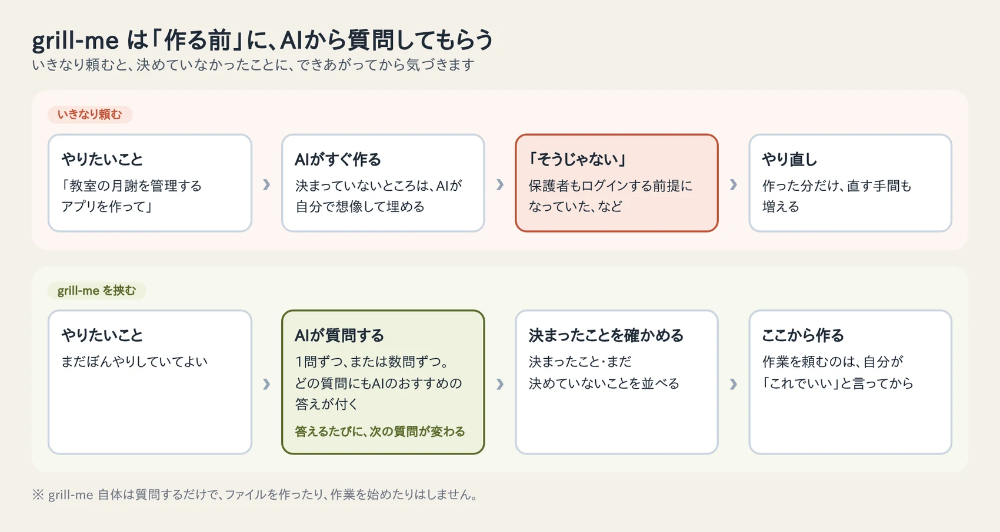
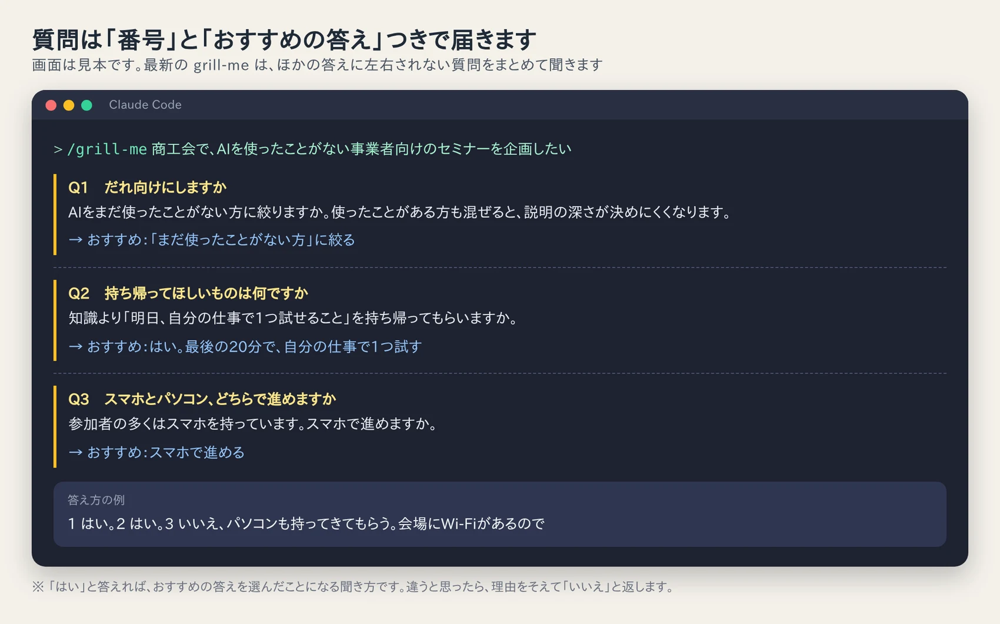
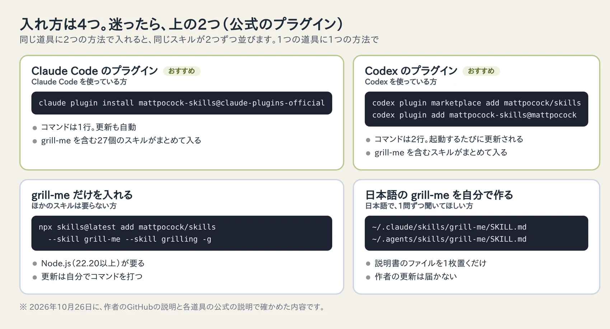

<!-- 画像プレースホルダー（ヒーロー）: 玉城祐輔がノートパソコンの前で、Riraが差し出す番号付きの質問カードを見ながら考えている場面
     生成後の保存先: src/assets/blog/grill-me-skill-claude-code-codex/hero-tamashiro-yusuke-rira-question-cards.webp
     → 画像設置後、フロントマターに heroImage: '../../assets/blog/grill-me-skill-claude-code-codex/hero-tamashiro-yusuke-rira-question-cards.webp' を足す -->

「AIに頼んだら、すぐに作ってくれた。でも、できあがったものを見て『そうじゃない』となった」

Claude Code や Codex のような、作業まで進めてくれるAIを使い始めると、一度はこうなります。

AIが悪いわけではありません。頼んだ側が決めていなかったところを、AIが想像で埋めて作っただけです。そして、自分が何を決めていなかったのかは、できあがったものを見るまで気づけません。

grill-me（グリル・ミー）は、この「決めていなかったこと」を、作る前に見つけるためのスキルです。AIに作業を頼む代わりに、**AIのほうから質問してもらいます。**

私は2026年の7月から、事業の方針やアプリの設計を考えるときに使っています。この記事では、grill-me が何をするのかと、Claude Code と Codex への入れ方を、2026年10月時点の最新の手順でまとめます。

## 先に結論：作る前に「質問攻め」にしてもらう道具

grill-me を一言でいうと、**やりたいことを伝えると、AIが質問を重ねて、考えの抜けを埋めてくれる**スキルです。

- 質問には、どれもAIの「おすすめの答え」が付きます。迷ったら「はい」と答えれば進みます
- ファイルを作ったり、作業を始めたりはしません。質問して、決まったことを確かめるだけです
- 自分で呼んだときだけ動きます。AIが勝手に質問を始めることはありません

入れ方は、Claude Code ならコマンド1行、Codex なら2行です。日本語で1問ずつ聞いてほしい方は、説明書のファイルを1枚自分で置く方法もあります。



## grill-me は何をするのか

### スキルは「AIに渡す作業の説明書」

スキル（Skill）は、AIに「この仕事は、この手順でやって」と教えておく説明書のファイルです。Claude Code や Codex は、決まった場所に置いたスキルを読み込み、呼ばれたときにその手順で動きます。

grill-me は、TypeScript（プログラムの言語の1つ）の講師として知られるエンジニア、Matt Pocock さんが公開しているスキルです。自由に使ってよい MIT ライセンスで、GitHub の [mattpocock/skills](https://github.com/mattpocock/skills) にまとめて置かれています。作者自身が「いちばん人気のスキル」と紹介しているものです。

### 決めることを「木」のように広げて、上から順に聞く

grill-me に計画を伝えると、AIはまず「この計画を進めるには、何を決める必要があるか」を洗い出します。

決めることには順番があります。たとえば「だれ向けのセミナーか」が決まらないと、「どこまで詳しく説明するか」は決められません。grill-me はこのつながりを木の枝のように整理し、先に決めるべきことから質問します。

答えると、その答えに合わせて次の質問が変わります。これを、枝がすべて片づくまで続けます。

### 2026年10月の時点では「まとめて聞く」形になっている

grill-me は、作者が何度も手を入れて変わってきました。以前は「1回に1問だけ聞く」形でしたが、いまは次の形になっています。

- ほかの答えに左右されない質問は、1回にまとめて聞く（番号つき）
- どの質問にも、AIのおすすめの答えを1行で付ける
- 「はい」と答えれば、おすすめの答えを選んだことになる聞き方にする
- 自分で調べればわかる事実は、AIが調べる。聞くのは、本人が決めることだけ

答えるときは「1 はい。2 はい。3 いいえ、理由は…」のように、番号で返せます。



1問ずつのほうが考えやすい方は、元に戻せます。やり方は、記事の後半の「日本語で、1問ずつ聞いてほしい方へ」に書きました。

## 私はこんな場面で使っています

grill-me を入れてから、私は「計画を詰めるときは grill-me を使う」と、AIに守ってもらう決まりの中に書いています。実際に使った場面を3つ紹介します。

### 小さな教室向けのアプリを考えたとき：20問で「作らないもの」が決まった

子ども向けの習い事教室で、月謝やイベント代の受け取りを記録する小さなアプリを考えたときです。最初は「月謝を管理するアプリ」くらいの、ぼんやりした考えでした。

grill-me に20問ほど聞かれて、次のようなことが決まりました。

- アプリを使うのは運営する人だけ。保護者への連絡は、いつものLINEのまま
- 毎月の月謝は自動で作らず、運営する人が「今月分を発行」を押す
- 支払いの仕組みや領収書は作らない。受け取ったかどうかの記録だけにする

自分では「決めた」と思っていなかったことばかりです。特に「保護者はアプリにログインしない」は、聞かれなければ、AIが保護者用の画面まで作っていたと思います。

この日はアプリを1行も作らず、決まったことと、まだ決めていない4つを書き残して終えました。

### コミュニティを立ち上げるとき：判断の基準まで決まった

AIの使い方を学び合うコミュニティを立ち上げようとしたときは、だれ向けにするか、会費、集まり方、どの名前で開くかなど、8つのことを grill-me で決めました。

最後に「いつまでに、どうなっていたら続けるか」という判断の基準まで決まったのが、自分では大きかったです。ひとりで考えていると、ここはたいてい後回しにしてしまいます。

### おすすめの答えに、1つだけ「いいえ」と言った日

経理の作業をAIで楽にする仕組みを、ほかの人と組んで提供できないか考えたときも、8問で方針を決めました。

8問のうち7問は、AIのおすすめの答えのままでした。ただ、最後の「最初に声をかける相手」だけは、AIが挙げた人から、別の人の名前に直しました。AIは私の人間関係までは知らないからです。

おすすめの答えが付いていると、つい全部「はい」と返したくなります。でも、全部「はい」で終わるなら、それはAIが考えた計画にうなずいただけです。私は**1回の grill-me で、少なくとも1つは自分の言葉で答える**ようにしています。

<!-- 画像プレースホルダー: 悩める社長がRiraから質問カードを1枚ずつ受け取り、首をかしげながら考えている場面
     生成後の保存先: src/assets/blog/grill-me-skill-claude-code-codex/rira-worried-business-owner-question-cards.webp
     alt: AI秘書のRiraが番号の付いた質問カードを1枚ずつ差し出し、悩める社長がカードを手に持って首をかしげながら答えを考えているイラスト
     → 画像設置後、この行を  に置き換える -->

## 始める前に確認すること

### Claude Code か Codex が入っていること

この記事の入れ方は、Claude Code（Anthropic のAI）か Codex（OpenAI のAI）を、パソコンですでに使っている方向けです。どちらも、ターミナル（文字でパソコンに指示を出す黒い画面）や、デスクトップアプリの中で動きます。

ChatGPT や Claude のチャットの画面だけを使っている方は、記事の最後の「よくある質問」に、同じ聞き方をしてもらう依頼文を載せました。そちらから試せます。

### 入れ方は4つ。1つの道具には1つだけ

grill-me の入れ方は、作者の説明で4つに分かれます。

- Claude Code のプラグインとして入れる（おすすめ）
- Codex のプラグインとして入れる（おすすめ）
- grill-me だけを入れる
- 日本語の grill-me を自分で作る

プラグインは、いくつかのスキルをまとめて入れられるパッケージです。作者の更新が自動で届くので、迷ったらプラグインを選んでください。

気をつけたいのは、**同じ道具に2つの方法で入れないこと**です。プラグインと、grill-me だけの入れ方を両方使うと、同じスキルが2つずつ並んでしまいます。



## Claude Code に入れる

### ターミナルから入れる

ターミナルを開き、次の1行を貼って実行します。

```bash
claude plugin install mattpocock-skills@claude-plugins-official
```

`claude-plugins-official` は、Anthropic が用意している公式のプラグイン置き場の名前です。`Successfully installed plugin` と出たら完了です。何も指定しないと「自分用」として入り、どのフォルダで Claude Code を開いても使えます。

このパソコンで一度も Claude Code を開いたことがない場合は、公式の置き場がまだ登録されていないことがあります。そのときは、先に次の1行を実行してから、もう一度入れてください。

```bash
claude plugin marketplace add anthropics/claude-plugins-official
```

### Claude Code の画面の中から入れる

Claude Code を開いている途中なら、入力欄に次のように打っても入れられます。

```text
/plugin install mattpocock-skills@claude-plugins-official
```

この場合はすぐには入らず、プラグインの中身を見る画面が開きます。入るスキルの一覧を確かめてから、入れる範囲を選びます。

- **Install for you (user scope)**：自分用。どのフォルダでも使える
- **Install for all collaborators on this repository (project scope)**：このフォルダで作業する全員が使う
- **Install for you, in this repo only (local scope)**：自分だけ、このフォルダの中だけで使う

ひとりで使うなら、一番上の「自分用」で大丈夫です。

デスクトップアプリの「Code」の画面で使っている方は、入力欄の横の「＋」から「Add plugins」を選び、`mattpocock-skills` を探して入れることもできます。

### 入ったかを確かめる

入力欄に `/` を打ち、続けて `grill` と打つと、候補に grill-me が出てきます。プラグインで入れたスキルは、`/mattpocock-skills:grill-me` のように、プラグインの名前が頭に付いた形で表示されます。

ターミナルで確かめるときは、次の1行です。

```bash
claude plugin list
```

すでに開いていた画面では、入れたプラグインがまだ読み込まれていないことがあります。そのときは `/reload-plugins` と打つか、Claude Code を開き直してください。

### 更新と、やめるとき

公式の置き場から入れたプラグインは、自動で新しいものに更新されます。自分ですることはありません。

使わなくなったら、次の1行で外せます。

```bash
claude plugin uninstall mattpocock-skills@claude-plugins-official
```

このプラグインには、grill-me のほかに、作者の作ったスキルが合わせて27個入っています（2026年10月時点）。ほかのスキルは、自分で呼ばなければ使われません。

## Codex に入れる

### ターミナルから2行で入れる

Codex は、作者の GitHub をプラグインの置き場として登録してから、プラグインを入れます。ターミナルで、次の2行を1行ずつ実行してください。

```bash
codex plugin marketplace add mattpocock/skills
codex plugin add mattpocock-skills@mattpocock
```

1行目で置き場を登録し、2行目でプラグインを入れています。2行目の `@mattpocock` は、1行目で登録した置き場の名前です。

入ったかどうかは、次の1行で確かめられます。

```bash
codex plugin list
```

### 新しく開いて、$grill-me で呼ぶ

入れたスキルは、Codex を新しく開いたときから使えます。開いていた画面は一度閉じて、もう一度 `codex` で開いてください。

Codex では、スキルを `$` で呼びます。入力欄に `$grill-me` と打ち、そのあとに考えたいことを書きます。

```text
$grill-me 商工会で、AIを使ったことがない事業者向けのセミナーを企画したい
```

`/skills` と打って、一覧から選ぶこともできます。grill-me は、自分で呼んだときだけ動くように作られているので、Codex が勝手に質問を始めることはありません。

### 更新と、やめるとき

作者の説明では、Codex のプラグインは起動するたびに更新されます。手で新しくしたいときは、次の1行です。

```bash
codex plugin marketplace upgrade mattpocock
```

外すときは、次の1行です。

```bash
codex plugin remove mattpocock-skills@mattpocock
```

## grill-me だけを入れたい方へ

ほかのスキルは要らない、grill-me だけを入れたい、という方は、skills という入れ方の道具を使います。Node.js（プログラムを動かすための土台のソフト）の 22.20 以上が要ります。ターミナルで `node -v` と打つと、入っているかとバージョンがわかります。

```bash
npx skills@latest add mattpocock/skills --skill grill-me --skill grilling -a claude-code -a codex -g
```

grill-me と一緒に、grilling も入れているところがポイントです。いまの grill-me の中身は「grilling を使って」と書かれた短い説明書で、質問の進め方は grilling のほうに書かれています。grill-me だけを入れると、うまく動きません。

それぞれの部分の意味は次のとおりです。

- `-a claude-code -a codex`：Claude Code と Codex の両方に入れる。片方だけなら、要らないほうを消す
- `-g`：自分用として入れる。Claude Code は `~/.claude/skills/`、Codex は `~/.agents/skills/` に置かれる

この入れ方では、更新は自分でします。

```bash
npx skills@latest update -g
```

外すときは、次の1行です。

```bash
npx skills@latest remove grill-me grilling -g
```

作者の説明の2つ目の手順にある `/setup-matt-pocock-skills` は、プログラムを書くためのスキルを使うときの準備です。grill-me だけを使うなら要りません。

## 日本語で、1問ずつ聞いてほしい方へ

grill-me は英語で書かれていますが、日本語で話しかければ、たいてい日本語で質問が返ってきます。それでも、「まとめて聞かれると考えにくい」「必ず日本語で聞いてほしい」という方もいると思います。方法は2つあります。

### 方法1：いつもの指示に1行足す

作者自身が、1問ずつに戻す方法として紹介しているやり方です。Claude Code なら `~/.claude/CLAUDE.md`、Codex なら `~/.codex/AGENTS.md` という、AIが毎回最初に読む指示のファイルに、次の1行を足します。

```text
grill-me で質問するときは、1回に1問だけ、日本語で聞いてください。
```

プラグインの更新はそのまま届くので、手間が少ない方法です。

### 方法2：日本語の grill-me を自分で作る

私はこちらを使っています。作者の grill-me をもとに、日本語で、1回に1問だけ聞く説明書を自分用に書き、Claude Code と Codex の両方から同じファイルを読ませています。

作り方は、決まった場所にフォルダを作り、`SKILL.md` という名前のファイルを1枚置くだけです。

- Claude Code：`~/.claude/skills/grill-me/SKILL.md`
- Codex：`~/.agents/skills/grill-me/SKILL.md`

中身は、たとえば次のように書きます。

```markdown
---
name: grill-me
description: 計画や考えを、質問を重ねて詰める。「グリルして」「grill me」「計画を詰めて」と頼まれたときに使う。
disable-model-invocation: true
---

# grill-me（日本語・1問ずつ）

相手の計画や考えについて、共通の理解に届くまで質問を重ねる。作業や資料づくりには入らない。

- 1回に1問だけ、日本語で聞く
- 質問には、必ずあなたのおすすめの答えと、その理由を付ける
- ファイルを読めば分かる事実は自分で調べて、聞かない
- ほかの答えで変わる質問はあとに回し、先に決めるべきことから聞く
- 相手が「わからない」と答えたら、おすすめの答えで進めてよいかを聞く
- 相手が「もう十分」と言ったら、すぐに終える
- 終わったら「決まったこと」「まだ決めていないこと」「次にやること」を短くまとめる
- 相手が「これで進めて」と言うまで、作業を始めない
```

3行目の `disable-model-invocation: true` は、Claude Code に「自分からは使わず、呼ばれたときだけ使う」と伝える設定です。

フォルダの名前が `.` で始まるので、Mac の Finder やWindowsのエクスプローラーでは見えにくい場所です。自分で作るのが不安な方は、Claude Code か Codex に次のように頼むと、ファイルを作ってくれます。

```text
次の内容で、~/.claude/skills/grill-me/SKILL.md を作ってください。
フォルダが無ければ作ってください。作ったら、置いた場所を教えてください。

（ここに、上の SKILL.md の中身を貼る）
```

自分で作った grill-me と、プラグインや skills で入れた grill-me を同じ道具に入れると、同じ名前のスキルが並んで紛らわしくなります。自分で作るなら、ほかの入れ方は使わないでください。また、作者の更新は届かなくなります。ときどき [作者の GitHub](https://github.com/mattpocock/skills/tree/main/skills/productivity) を見て、よい変更があれば自分の説明書に取り込みます。

## grill-me をうまく使うコツ

### 新しい会話で始める

grill-me は、新しい会話の最初に呼ぶのがいちばん効きます。AIがすでに計画を書いたあとに呼ぶと、その計画に引っぱられた質問になりやすいからです。

Claude Code のプランモード（作業の前に計画を書く使い方）も、grill-me のあいだは切っておきます。作者の説明では、プランモードだとAIが計画を書くことを急いで、質問が足りなくなります。

### 「わからない」と答えてよい

わからない質問には、「わからない」と答えて大丈夫です。grill-me は、おすすめの答えで進めてよいかを聞き返してくれます。

画面の見た目や、使い心地のように、話し合いでは決めにくい質問もあります。作者は、そういう質問は一度止めて、捨ててもよい試作品を作って見てから答えるよう勧めています。

### 終わったら、決まったことを残してもらう

grill-me は、ファイルを作りません。質問が終わったら、「決まったことと、まだ決めていないことを、ファイルにまとめて」と頼んで、記録に残してもらいます。私はこの記録を、次に作業を頼むときの最初の資料にしています。

### 質問が終わらないときは、範囲を分ける

質問が何十問も続いて終わらないときは、一度に考える範囲が広すぎることがほとんどです。「アプリ全体」をやめて「月謝の記録のところだけ」のように分けてから、もう一度 grill-me を呼びます。

<!-- 画像プレースホルダー: 玉城祐輔がノートパソコンに向かい、画面に並ぶおすすめの答えのうち1つを指さして「ここは違う」と自分の言葉で答えている場面
     生成後の保存先: src/assets/blog/grill-me-skill-claude-code-codex/tamashiro-yusuke-answer-in-own-words.webp
     alt: 玉城祐輔がノートパソコンの前で、画面に並んだ質問カードの1枚を指さし、自分の言葉で答えを書き足しているイラスト
     → 画像設置後、この行を  に置き換える -->

## よくある質問

### お金はかかりますか

grill-me そのものは、MIT ライセンスで公開されていて無料です。ただし、Claude Code や Codex を使うには、それぞれのサービスの契約が要ります。

### プログラムを書かない仕事にも使えますか

使えます。作者も、grill-me はプログラムでなくてもよく、事業の判断や文章、次に何をするかを考えるときにも使える、と説明しています。私が使った3つの場面も、うち2つはプログラムと関係のない話です。

### ChatGPT や Claude のチャットの画面でも使えますか

スキルとしては入れられませんが、同じ聞き方をしてもらうことはできます。会話の最初に、次の依頼文を貼ってから、考えたいことを書いてください。

```text
これから私の計画について、質問を重ねて一緒に詰めてください。次のルールを守ってください。

・1回に1問だけ、日本語で聞いてください
・質問には、あなたのおすすめの答えと理由を必ず付けてください
・先に決めるべきことから順に聞いてください
・私が「わからない」と答えたら、おすすめの答えで進めてよいかを聞いてください
・私が「もう十分」と言ったら終えて、決まったこと・まだ決めていないこと・次にやることを短くまとめてください
・私が「これで進めて」と言うまで、資料づくりや作業は始めないでください

私の計画：（ここに書く）
```

### 勝手に質問を始めることはありませんか

ありません。作者の grill-me は、自分で `/grill-me`（Codex では `$grill-me`）と呼んだときだけ動くように作られています。

### 入れても大丈夫なものですか

スキルは、AIが読む手順書です。入れたスキルは、AIがその手順どおりに動くので、知らない人が作ったものは中身を見てから入れるのが安全です。grill-me は、中身が短い文章だけのスキルです。気になる方は、入れる前に [grill-me の説明書](https://github.com/mattpocock/skills/blob/main/skills/productivity/grill-me/SKILL.md)と [grilling の説明書](https://github.com/mattpocock/skills/blob/main/skills/productivity/grilling/SKILL.md)を開いて読んでみてください。

## 公式の情報（2026年10月26日に確認）

- [mattpocock/skills（作者の GitHub。入れ方の説明は README）](https://github.com/mattpocock/skills)
- [Claude Code のプラグインの入れ方と管理（Anthropic 公式）](https://code.claude.com/docs/en/discover-plugins)
- [skills の入れ方の道具（vercel-labs/skills）](https://github.com/vercel-labs/skills)

grill-me も、Claude Code や Codex も、変わるのが速い道具です。コマンドがうまく動かないときは、先に作者の README で最新の入れ方を確かめてください。
