<!-- product-article-character-sheets: tamashiro-yusuke-character-sheet-v5.png, tl-four-character-style-master-v2.png, tamashiro-yusuke-business-casual-character-sheet-v3.png, rira-character-sheet-v3.png, worried-business-owner-character-sheet-v1.png, accounting-staff-character-sheet-v1.png -->
<!-- product-article-character-check: hero-and-body-verified -->

HiDock P1（ハイドック ピーワン）を買ったのに、箱から出したまま机の引き出しに入っている。録音まではできたけれど、そのあと何をすれば文字や要約になるのかが分からない。

私は普段からP1を相談や会議の記録に使っていて、まわりの方からこの相談をよく受けます。使い方は、慣れれば難しくありません。つまずくのは、最初の準備と「録音したあとにWebへ送る」ところがイメージしにくいからだと感じています。

この記事では、P1を買った方に向けて、アカウント作成から録音、Webへの取り込み、要約づくりまでを、実際の画面に沿った図で順番に説明します。

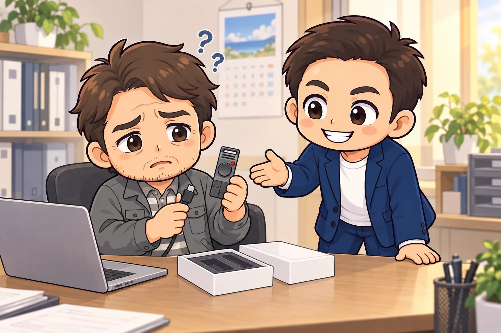

## 先に結論。準備は最初の1回だけ、あとは4つのくり返し

P1でやることは「録る・つなぐ・送る・読む」の4つです。最初の1回だけ、HiNotes（ハイノーツ）という専用のWebサービスにアカウントを作り、P1を登録しておきます。

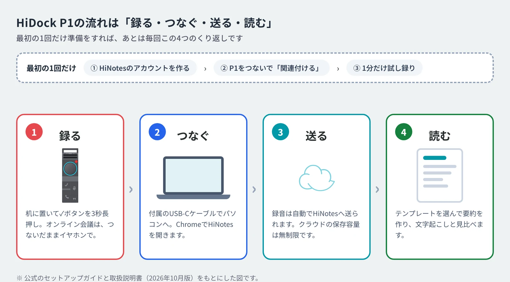

ここで一番大事なのは、**P1は録音するだけの道具で、文字起こしと要約はWeb側のHiNotesが作る**ということです。録音したら、P1をパソコンにケーブルでつなぎ、録音をHiNotesへ送ります。この「送る」が抜けていると、いつまでたっても要約はできません。

そして、P1を持っていれば、文字起こしと要約は月額料金なしで無制限に使えます。クラウド（インターネット上の保存場所）に保存できる量にも上限がありません。録音を残すかどうかを、料金や残り時間ではなく、記録が必要かどうかで決められます。

## 用意するもの

- **P1本体と、付属のUSB-Cケーブル**。両端がUSB-Cのケーブルです
- **パソコン（WindowsかMac）と、ブラウザのGoogle Chrome**。WindowsならMicrosoft Edgeでも使えます。公式の案内では、SafariとFirefoxは対応していません
- **メールアドレス**。GoogleかAppleのアカウントがあれば、それでも登録できます
- オンライン会議を録るなら、**Bluetoothイヤホン**

パソコンにUSB-Cの差し込み口がない場合は、変換アダプターが要ります。スマートフォンだけで使う方法は、後半の「よくある疑問」で触れます。

## 手順1 充電して、録音のボタンだけ覚える

P1はケーブルでパソコンにつなぐだけで充電できます。公式ガイドでは、10分の充電で約1時間の録音ができると案内されています。初日は、使う前にしっかり充電しておきます。

電源は、本体の左の側面にある電源ボタンを長押しすると入ります。本体が震えて、側面の小さなランプが白く光れば電源が入っています。パソコンにつないだときは自動で電源が入り、10分ほど何も操作しないと自動で切れます。

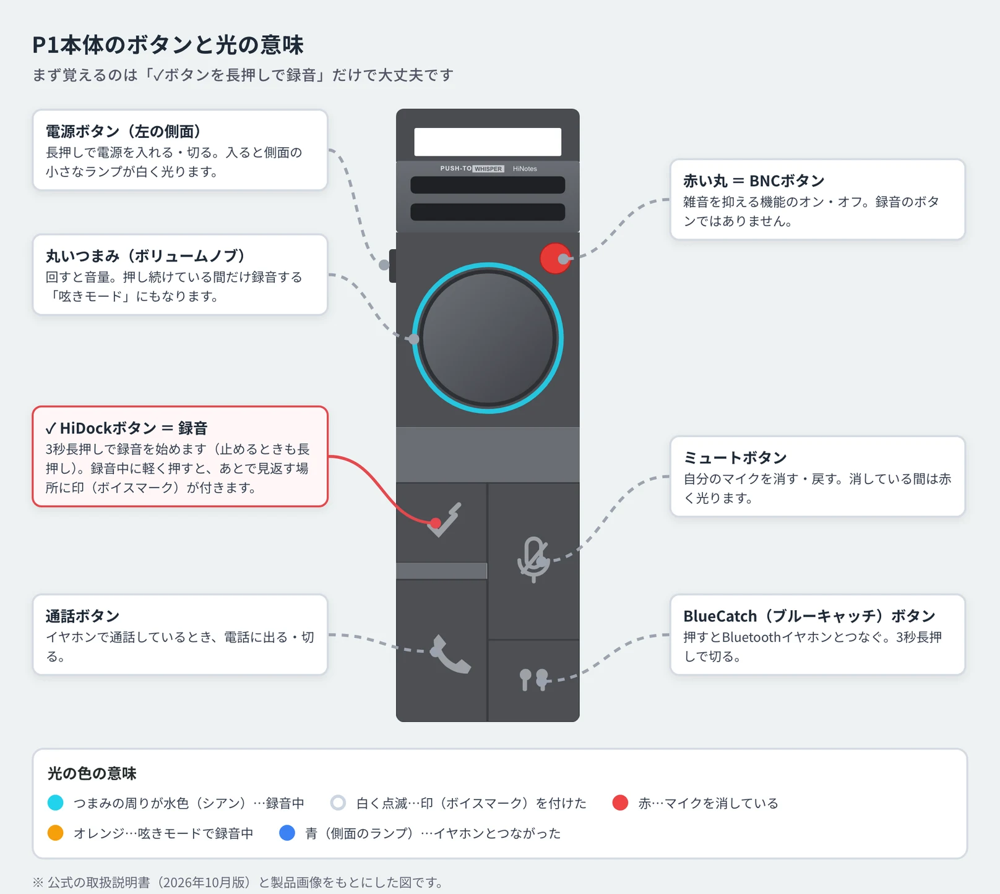

最初に覚えるのは、**左下の「✓」のボタンを3秒長押しすると録音が始まる**ことだけです。録音中は、真ん中の丸いつまみの周りが水色に光ります。

よく間違えるのが、上にある赤い丸のボタンです。これは雑音を抑える機能のオン・オフを切り替えるボタンで、録音のボタンではありません。

## 手順2 HiNotesのアカウントを作る

HiNotesは、HiDock社が用意している文字起こしと要約のWebサービスです。P1を買ったサイト（hidock.com）とは別のサイトなので、ここで迷う方が多いです。

パソコンのChromeで **hinotes.hidock.com** を開き、「HiNotesにログイン」を押します。ログインの画面の下にある「登録」から、アカウントを作ります。

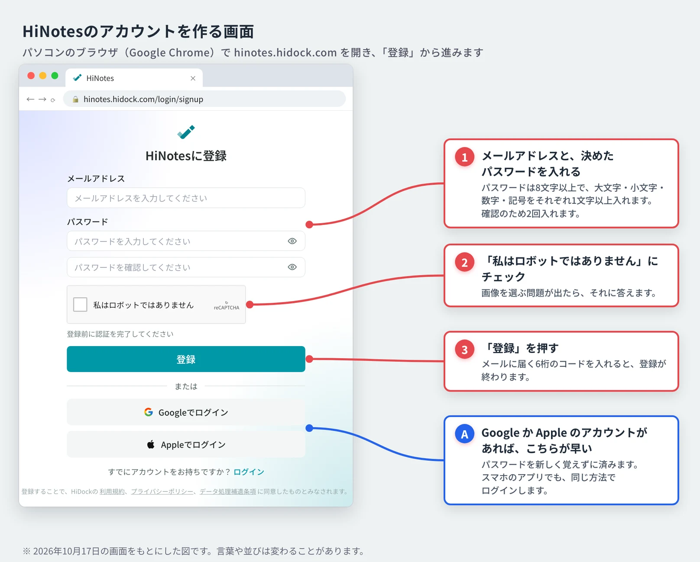

メールアドレスで登録すると、そのアドレスに6桁のコードが届きます。画面にそのコードを入れれば、登録は終わりです。公式の取扱説明書では、P1を買ったときと同じメールアドレスで登録するよう勧めています。

GoogleかAppleのアカウントで登録すると、新しいパスワードを覚えずに済みます。あとでスマートフォンのアプリを使うときも、同じ方法でログインします。

Chromeのアドレス欄の右側に出る「インストール」のアイコンを押すと、HiNotesをパソコンのアプリのように開けるようになります。毎回アドレスを入れなくて済むので便利です。

## 手順3 P1をつないで「関連付ける」

アカウントができたら、付属のケーブルでP1をパソコンにつなぎ、HiNotesを開いたままにします。P1が自動で見つかることもありますが、出てこないときは左下の「＋」から「デバイスを接続」を選びます。

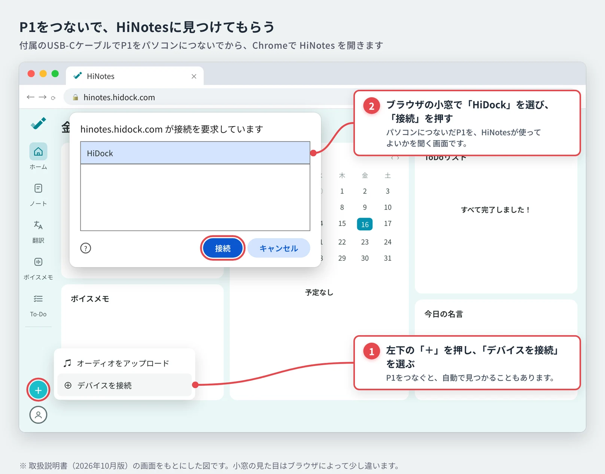

ブラウザの小窓に「接続を要求しています」と出たら、「HiDock」を選んで「接続」を押します。これは、パソコンにつないだP1をHiNotesが使ってよいかを、ブラウザが確かめる画面です。

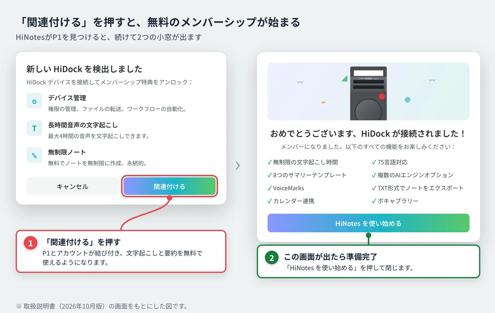

続けて出る「新しい HiDock を検出しました」の小窓で「関連付ける」を押します。これでP1とアカウントが結び付き、文字起こしと要約を無料で使える「メンバーシップ」が自動で始まります。「おめでとうございます」の画面が出れば、準備は終わりです。

このとき「ファームウェアアップデート」の案内が出ることがあります。ファームウェアは、P1本体を動かしている中のソフトのことです。「更新」を押すと3分ほどで終わり、その間はケーブルを抜かず、電源も切りません。

## 手順4 1分だけ試し録りする

本番の会議でいきなり使う前に、1分だけ試し録りをしておきます。私は、録音から要約までを一度最後まで通してみるのが、P1に慣れる一番の近道だと考えています。

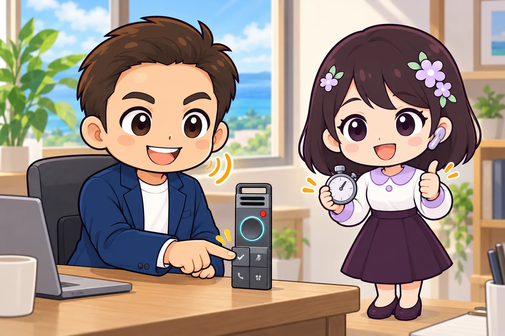

1. P1をケーブルから外して、机に置きます。外すと、まわりの声を録る「対面モード」になります
2. 「✓」のボタンを3秒長押しし、つまみの周りが水色に光ったら話し始めます
3. 自分の名前、会社名やお店の名前、仕事でよく使う言葉を、1分ほど話します
4. もう一度「✓」のボタンを長押しして録音を止めます

録音が終わったら、次の手順でHiNotesへ送り、文字起こしを見てみます。名前や会社名がどう文字になるかを先に知っておけば、本番の記録を読み直すときに慌てません。

## 手順5 つなぐと、録音が自動でHiNotesへ送られる

録音したP1をケーブルでパソコンにつなぎ、HiNotesを開きます。初めの設定では「自動転送」がオンになっていて、つなぐだけで録音がHiNotesへ送られ始めます。

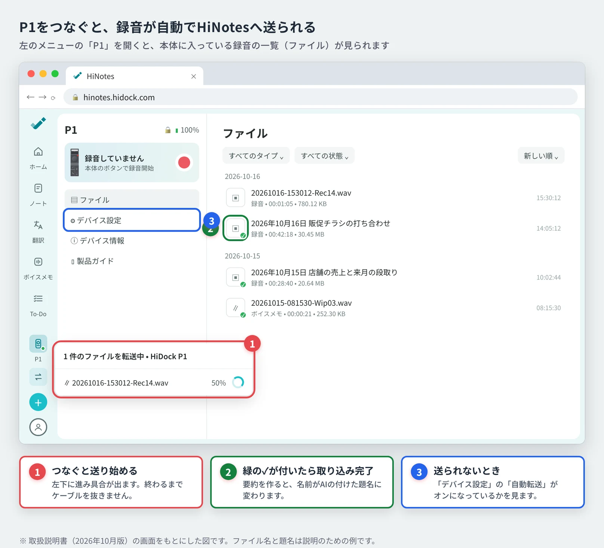

画面の左下に「1 件のファイルを転送中」と進み具合が出て、送り終わった録音には緑の✓が付きます。公式の製品ページでは、1時間の録音を1分かからずに送れると案内されています。送り終わるまでは、ケーブルを抜かないでください。

P1は、Wi-FiやBluetoothで録音を送る仕組みではありません。録音をHiNotesへ届けるには、毎回ケーブルでつなぐ必要があります。

## 手順6 録音を選んで、要約を作る

送った録音は、左のメニューの「ノート」に並びます。まだ要約を作っていない録音には、小さな赤い点が付いています。

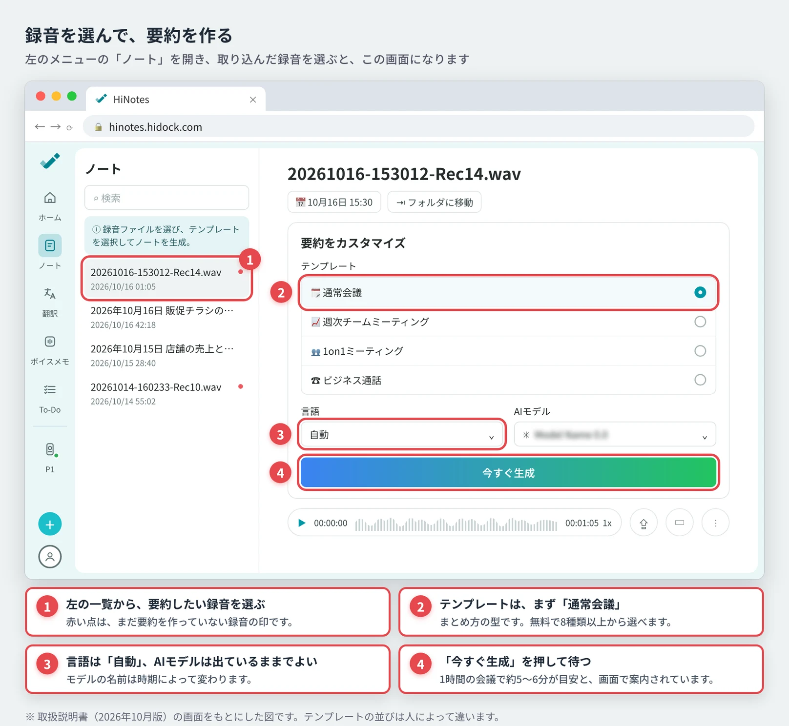

録音を選ぶと「要約をカスタマイズ」の画面になるので、次の順に選んで「今すぐ生成」を押します。

1. **テンプレート**は、まず「通常会議」を選びます。テンプレートは、要約のまとめ方の型です。無料で8種類以上から選べます
2. **言語**は「自動」のままにします
3. **AIモデル**は、最初に出ているものを選んだままでかまいません。名前は時期によって変わります

画面の案内では、1時間の会議で要約ができるまで5〜6分かかるとされています。画面を開いたまま待つ必要はなく、その間はほかの仕事を進められます。

## 手順7 文字起こしと見比べて、書き出す

要約ができると、録音の名前がAIの付けた題名に変わり、真ん中に要約が出ます。下の吹き出しのボタンを押すと、右側に文字起こし（話した言葉をそのまま文字にしたもの）が時刻つきで並びます。

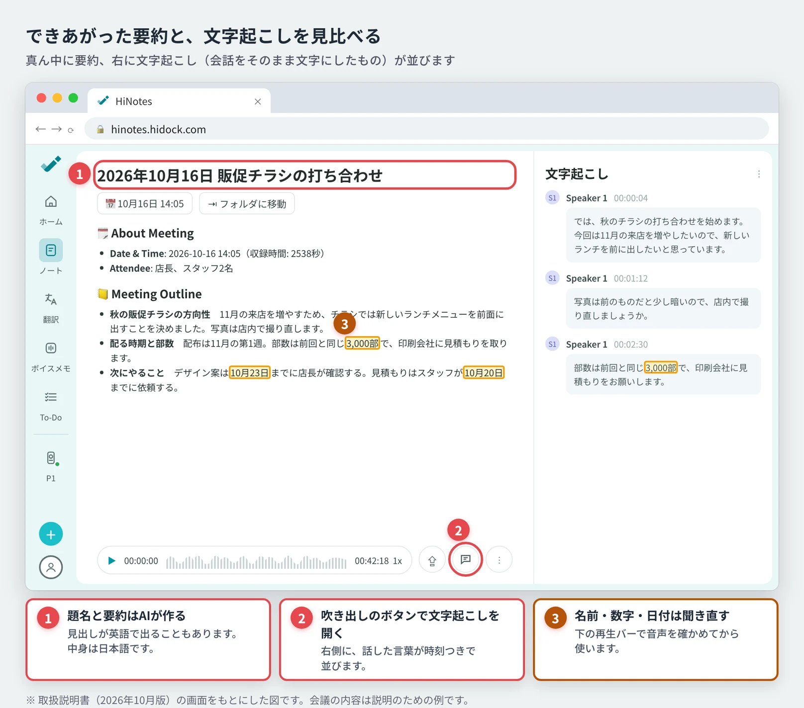

要約の見出しは、テンプレートによって英語で出ることがあります。中身は日本語で書かれています。

AIの要約は、そのまま議事録や報告書にはしません。人の名前、金額や部数、日付や期限は、文字起こしと見比べ、必要なら下の再生バーで音声を聞き直してから使います。

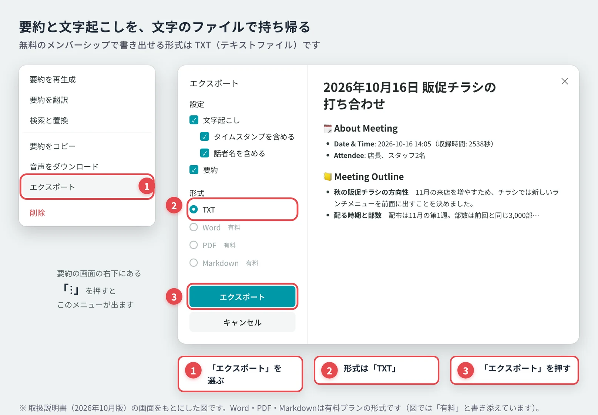

要約を報告書やメールに使うときは、右下の「⋮」から「要約をコピー」を選んで貼り付けるのが手軽です。ファイルで残したいときは「エクスポート」を選び、形式を「TXT」にして書き出します。無料のメンバーシップで書き出せるのは、このTXT（テキストファイル）です。

## オンライン会議を録るときの設定

Zoom、Microsoft Teams、Google Meetなどのオンライン会議では、P1をパソコンにつないだまま、Bluetoothイヤホンを**パソコンではなくP1に**つなぎます。公式はこのしくみを「BlueCatch（ブルーキャッチ）」と呼んでいます。

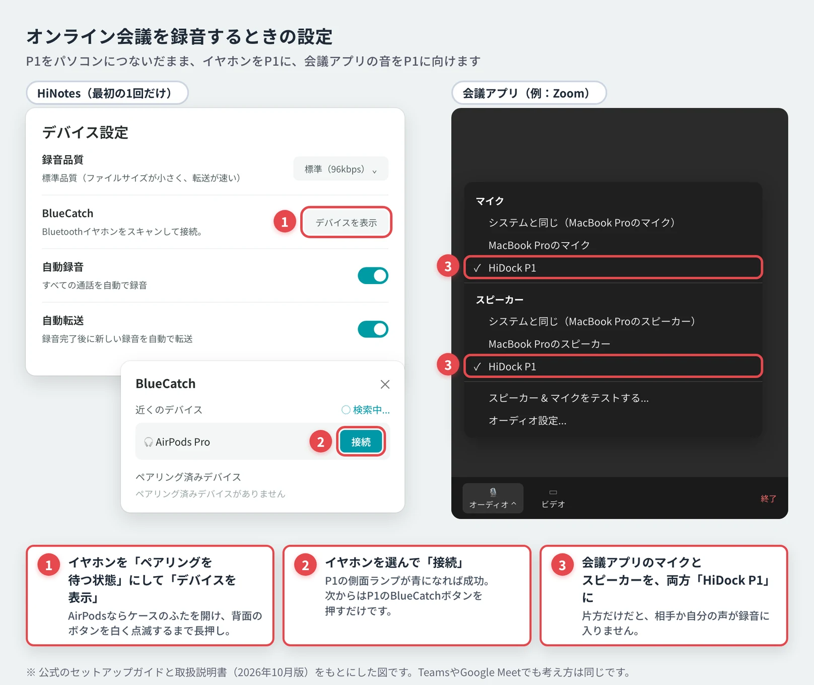

最初の1回は、HiNotesでP1を開き、「デバイス設定」の「BlueCatch」にある「デバイスを表示」を押します。イヤホンをペアリング（機器どうしを登録すること）を待つ状態にし、一覧に出たイヤホンを選んで「接続」を押します。AirPodsの場合は、イヤホンをケースに入れたままふたを開け、ケースの背面のボタンを、ランプが白く点滅するまで長押しします。AirPods 4は、ケースの正面を2回たたきます。

P1の側面のランプが青く光れば成功です。次からは、P1の電源を入れると自動でつながり直し、つながらないときは本体のBlueCatchボタン（イヤホンの絵のボタン）を1回押します。

会議アプリでは、**マイクとスピーカーの両方を「HiDock P1」にする**のを忘れないでください。片方だけだと、自分か相手の声が録音に入りません。「デバイス設定」の「自動録音」がオンなら、通話が始まると自動で録音されます。大事な会議の前には、一人で短いテスト通話をして、両方の声が入るかを試しておきます。

## 買い切りで、どこまで無料で使えるか

P1は本体を買えば、HiNotesの基本の機能を月額料金なしで使えます。HiNotesにP1を関連付けた時点で、無料のメンバーシップが自動で付きます。

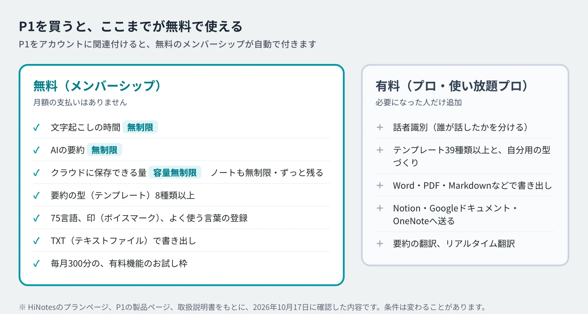

公式の製品ページには「文字起こし・要約が無制限かつ無料」「クラウドストレージ：容量無制限」とあります。P1を関連付けるときの画面にも「無料でノートを無制限に作成、永続的」と書かれています。

ネット上には「無料のノートは30個まで」と書かれた記事もあります。これは、2024年の公式ガイドに書かれていた、HiDockの機器を持っていないアカウントの制限と同じ内容です。P1を関連付けたアカウントは、先ほどの「無制限」の扱いになります。

有料になるのは、話者識別（誰が話したかを分ける機能）、テンプレートの追加や自分用の型づくり、Word・PDFでの書き出し、NotionやGoogleドキュメントへの送信、要約の翻訳などです。私は、文字起こしと要約を読んで自分で下書きを作れば足りるので、無料の範囲で使っています。毎月300分は有料機能のお試し枠も付くので、有料のプランが要るかどうかは、使ってみてから決めれば十分です。

## 毎日の流れにする。録ったら、その日のうちにつなぐ

P1を続けて使えるかどうかは、「つなぐ」を習慣にできるかで決まると私は考えています。録音が本体にたまったままだと、あとでまとめて送るのが面倒になり、要約を作るのも後回しになります。

おすすめは、1日の仕事の終わりに、P1をパソコンにつないで充電する場所を決めておくことです。つなげば録音は自動で送られ、充電もできます。翌朝HiNotesを開いて要約を作れば、前の日の相談や会議を、記憶が新しいうちに整理できます。

## つまずいたときの直し方

### P1が見つからない、小窓に出てこない

まず、ChromeかEdgeでHiNotesを開いているかを見ます。そのうえで、ケーブルを抜き差しし、HiNotesのページを読み込み直します。ケーブルは付属のものを使ってください。充電専用のケーブルでは、パソコンとデータのやり取りができないことがあります。

### 録音が始まらない

赤い丸のボタンではなく、左下の「✓」のボタンを3秒長押しします。つまみの周りが水色に光れば録音中です。

### 録音がHiNotesに送られない

P1を開き、「ファイル」の一覧で緑の✓が付いているかを見ます。付いていなければ、「デバイス設定」の「自動転送」がオンになっているかを調べます。

### オンライン会議で、相手の声が入っていない

イヤホンがパソコンではなくP1につながっているか、会議アプリのマイクとスピーカーが両方「HiDock P1」になっているかを見直します。

### 名前や専門用語が、いつも違う文字になる

HiNotesの設定にある「語彙」に、よく使う言葉を登録しておくと、文字起こしで正しく出やすくなります。会社名、お店の名前、取引先の名前を最初に入れておくと便利です。

## よくある疑問

### スマートフォンだけでも使える？

使えます。公式は、iPhone 15以降（USB-Cの差し込み口があるもの）と、USB機器をつなげるAndroidに対応していると案内しています。スマートフォンにHiNotesのアプリを入れ、パソコンと同じアカウントでログインします。スマートフォンでも、録音を送るときはケーブルでつなぎます。iPhoneでP1が出てこないときの直し方は、公式のよくある質問に載っています。

### 1回でどれくらいの長さを録音できる？

公式のFAQでは、1つの録音は最長4時間、本体は続けて8時間動くと案内されています。録音の品質を「高品質」に変えた場合は、1つの録音が最長1時間になります。終日の研修では、休憩ごとに録音を区切り、その間に充電しておきます。

### 録音した会話は、AIの学習に使われる？

HiNotesが公開しているセキュリティの方針では、利用者のデータをAIの学習には使わないとしています。録音と文字起こしは、送るときも保存するときも暗号化されます。それでも私は、録音する前に相手の了承をもらい、パスワードなどクラウドへ送るべきでない話は録らないようにしています。

### P1の録音ボタンを押し忘れたら？

録っていない会話は、あとから文字にできません。会議が始まったら、つまみの周りが水色に光っているかを一度目で見ておくと、録り忘れを防げます。

## これから買う方へ

HiDock P1をまだ持っていない方は、しくみや向いている人を[録音時間を気にしないAIレコーダー、HiDock P1](/blog/hidock-p1-ai-recorder/)で紹介しています。下の紹介リンクから購入すると、紹介ページに載っている対象商品が10%OFFになると公式に案内されています。

  
  

    
HiDock公式・紹介リンク

    <h3>HiDock P1 AIボイスレコーダー</h3>
    
文字起こしと要約は、本体を買えば月額料金なしで使えます。対応する端末を公式ページで見てから購入してください。

    <a class="affiliate-product-button" href="https://jp.hidock.com/pages/referral-program?ref=uzxdtbsg" target="_blank" rel="sponsored noopener noreferrer">紹介リンクで公式サイトを開く</a>
    
広告・紹介リンクです。購入により玉城祐輔個人に特典が入る場合があります。割引の適用、価格、在庫、付属品、保証、返品条件は購入画面でご確認ください。

  

## 公式情報

- [HiDock P1 セットアップガイド](https://jp.hidock.com/blogs/user-guide/hidock-p1-setup-guide)
- [HiDock P1 よくある質問](https://jp.hidock.com/blogs/user-guide/hidock-p1-faq)
- [HiDock P1 取扱説明書（PDF）](https://cdn.shopify.com/s/files/1/0645/2019/2156/files/HiDock_P1_User_Manual_JP.pdf)
- [HiNotesアプリのインストール方法](https://jp.hidock.com/blogs/user-guide/how-to-install-hinotes-app)
- [HiNotesの機能とプラン](https://jp.hidock.com/pages/hinotes)
- [HiDock P1 公式製品ページ](https://jp.hidock.com/products/hidock-p1)
- [HiNotes（Webアプリ）](https://hinotes.hidock.com)

記事の中の画面の図は、2026年10月9日版の公式取扱説明書と、2026年10月17日に確かめたHiNotesの画面をもとに作ったものです。会議の内容やファイル名は、説明のための例です。製品の仕様、無料と有料の範囲、紹介リンクの条件は、2026年10月17日に公式情報で確かめました。
