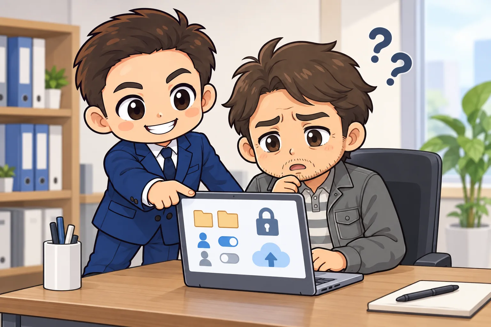

<!-- product-article-character-sheets: tamashiro-yusuke-character-sheet-v5.png, worried-business-owner-character-sheet-v1.png -->
<!-- product-article-character-check: hero-and-body-verified -->

[1本目](/blog/onedrive-desktop-jc-agenda/)と[2本目](/blog/jc-gian-google-shared-drive/)の記事で、JCの議案はパソコンで作り、上程（理事会に議案を出すこと）が終わったらGoogleドライブに残す、と書きました。

このやり方は、LOM（各地の青年会議所）や日本JC（日本青年会議所。全国のLOMをまとめる本会）の決まりではありません。規則も手引きも無いなかで、私が1人で勝手にやっていることです。

なので、この記事では「こうするべき」とは書きません。議案の保管と引き継ぎの案の1つとして、便利なところと、まだ決まりにしにくいところを両方並べます。

## 先に結論：便利な案の1つ。ただ、決まりにするには不確かなところが多い

Googleドライブの共有ドライブ（チームで持つ保管場所）に議案を残すと、次の年度の担当が、去年の議案を自分で探しに行けます。作った人が卒業しても、議案はLOMに残ります。

一方で、不確かなところもあります。

- 使う人に、デジタルの道具を使いこなす力（デジタルリテラシー）がある程度要る
- 日本JCとしての手引きが無いので、LOMによってやり方に差が出る
- 費用をおさえられる「Google Workspace for Nonprofits」は、審査に通るかどうかが申し込むまで分からない

本会も、このあたりを気にしているのかもしれません。全国の決まりにする前に、まずは1つのLOMの1つの委員会で試してみる。いまはそのくらいがちょうどよいと考えています。

## 私がいまやっていること

いまの私のやり方は、次のとおりです。

- 議案はパソコンのExcelやWordで作り、アジェンダにはZIPで上げる
- 上程が終わったら、議案フォルダをGoogleドライブの共有ドライブに上げる
- 共有ドライブは、私の会社で契約しているGoogle Workspace（会社や団体向けのGoogleの有料サービス）の中に作っている

フォルダの名前の付け方や、権限の渡し方、年度の替わり目にやることは、[2本目の記事](/blog/jc-gian-google-shared-drive/)にまとめています。

## 便利なところ：議案が、作った人でなくLOMの持ち物になる

共有ドライブに置いたファイルは、上げた人ではなくチームの持ち物になります。作った人が卒業しても、パソコンを買い替えても、議案はそのまま残ります。次の年度に同じ事業を担当した人は、「去年の議案はどこですか」と聞いて回らずに、自分で開きに行けます。

権限を分けられるのも助かります。委員を投稿者（ファイルを足す・直すはできるが、ゴミ箱には入れられない権限）にしておけば、うっかり議案を消してしまうことが起きにくくなります。年度が終わったら全員を閲覧者に替えると、前の年度の議案は、見ることはできても、管理者のほかは誰も消せない棚になります。

## 不確かなところ1：使う人に、デジタルの慣れが要る

このやり方を回すには、覚えることがいくつかあります。

- 共有ドライブと、マイドライブ（自分だけの保管場所）の違い
- 管理者・コンテンツ管理者・投稿者・閲覧者という4つの権限の違い
- 上げるときに、ExcelやWordをGoogleの形式に変えない設定
- 前の年度の議案をもとに作るときは、ZIPでダウンロードしてからパソコンで開くこと

私にとっては毎日の仕事で使う道具ですが、JCの会員の誰もがそうとは限りません。しかもJCは毎年、委員長も事務局も替わるので、詳しい人がいる年はうまく回っても、いない年には止まってしまうことがあります。

共有ドライブを管理する人が1人だけだと、その人が卒業したときに、権限を変えられる人がいなくなります。管理者を2人以上にしておくといった気配りも、慣れた人がいないと見落としがちです。

## 不確かなところ2：日本JCの手引きが無く、LOMによって差が出る

私の知るかぎり、議案をどこに保管し、次の年度へどう引き継ぐかについて、日本JCとしてのガイドライン（手引き）はありません。アジェンダシステムに上げた議案とは別に、元のExcelやWordをどう残すかは、LOMや委員長ごとに考えることになります。

手引きが無いと、やり方はLOMごとにばらばらになります。Googleドライブに残すLOMもあれば、個人のパソコンやUSBメモリに残るままのLOMもあるはずです。同じLOMの中でも、委員長が替わればやり方が変わるかもしれません。

Googleドライブのやり方も、使いこなせる人がいるLOMでは回りますが、いないLOMでは回りません。手引きが無いまま広げると、LOMの間の差がかえって広がるおそれがあります。

## 不確かなところ3：Nonprofitsのプランは、審査に通るか分からない

議案をLOMの持ち物として残すなら、LOMがGoogle Workspaceを契約するのがいちばん安心です。ただ、毎月の費用がかかります。

そこで気になるのが、非営利団体向けの「[Google Workspace for Nonprofits](https://www.google.com/intl/ja/nonprofits/offerings/workspace/)」です。Googleの公式の案内では、料金は次のとおりです（2026年10月17日に確認）。

- Google Workspace for Nonprofits：1人あたり月0円
- Business Standard：1年契約で1人あたり月400円（通常の料金の75%引き）

とてもお得です。ただ、使うには、Google for Nonprofits（非営利団体向けの仕組み）の審査に通る必要があります。Googleの公式ヘルプ「[参加資格](https://support.google.com/nonprofits/answer/3215869?hl=ja)」では、日本で対象になる団体として一般社団法人と公益社団法人が挙がっていて、審査はGoodstackという会社が受け持っています。

多くのLOMは一般社団法人か公益社団法人なので、対象に入りそうに見えます。けれど、申請を手伝う団体の案内の中には、「非営利型の一般社団法人に限る」と書いているものもあります。実際に通るかどうかは、申し込んでみるまで分かりません。

審査に通らなければ、通常の料金で契約することになります。全国の決まりにするなら、「無料で使える」ことを前提にはできません。

## 本会が慎重になる理由は、このあたりかもしれない

ここからは、私の想像です。

全国のLOMに同じやり方をすすめるなら、詳しい人がいないLOMでも回せること、費用の見通しが立つこと、会員の名前や連絡先が入った議案を安全に扱えることが要ると思います。

Googleドライブのやり方は、いまのところ、どれもLOMによって答えが変わります。本会が「議案はGoogleドライブに残してください」とすぐに言えないのは、こうした不確かさを気にしているからかもしれません。私も、それは無理もないと思っています。

## それでも試すなら、小さく始める

決まりが無いということは、LOMや委員会ごとに試せるということでもあります。私なら、次のように始めます。

- まずは1つの委員会で、1年だけ試す
- 管理者は、事務局長や専務理事など、年度をまたいで関わる人を2人以上にする
- LOMの契約が無く、個人や個人の会社のアカウントで始めるなら、年度末に議案をどう渡すかを最初に決めておく
- 年度が終わったら、次の委員長が前の年度の議案を見つけられたかを確かめる

うまくいけば、次の年度は試す委員会を増やせます。LOMでGoogle Workspaceを契約するかどうかを話し合うときの材料にもなります。うまくいかなかったところも、ほかのLOMが同じつまずきを避けるための手がかりになります。

## よくある質問

### この方法は、LOMや日本JCの決まりですか

いいえ。私が1人でやっていることをもとにした案です。

### Nonprofitsの審査に通らなかったら、どうしますか

LOMで通常の料金のGoogle Workspaceを契約するか、委員長などが自分の会社のGoogle Workspaceで始める方法があります。自分の会社のアカウントで始めるときは、年度末に議案をどう渡すかを、最初に決めておいてください。

### 無料のGoogleアカウントではだめですか

無料のGoogleアカウントでは、共有ドライブを作れません。マイドライブのフォルダは作った人の持ち物なので、その人が卒業すると、議案が見つからなくなります。
