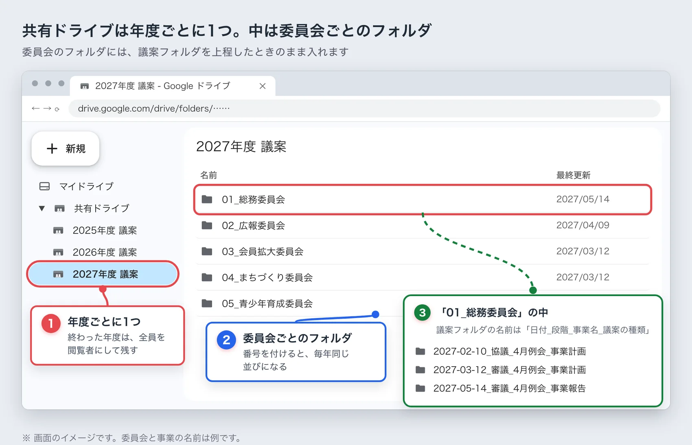
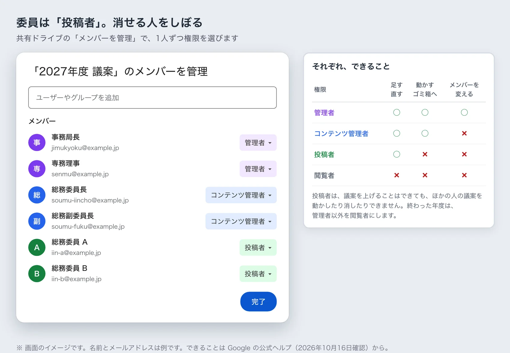
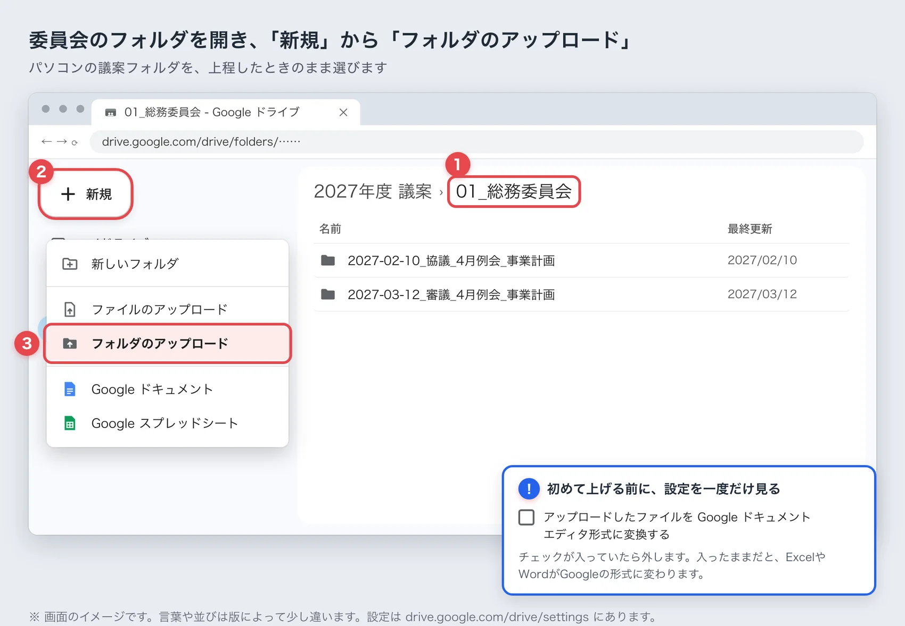
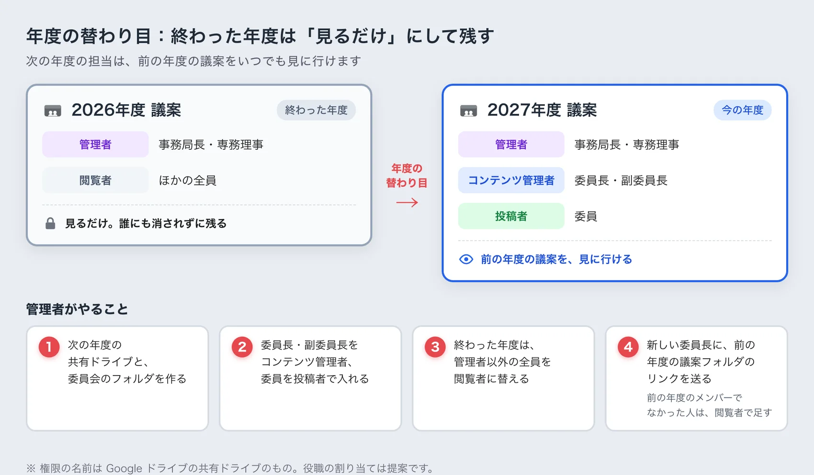
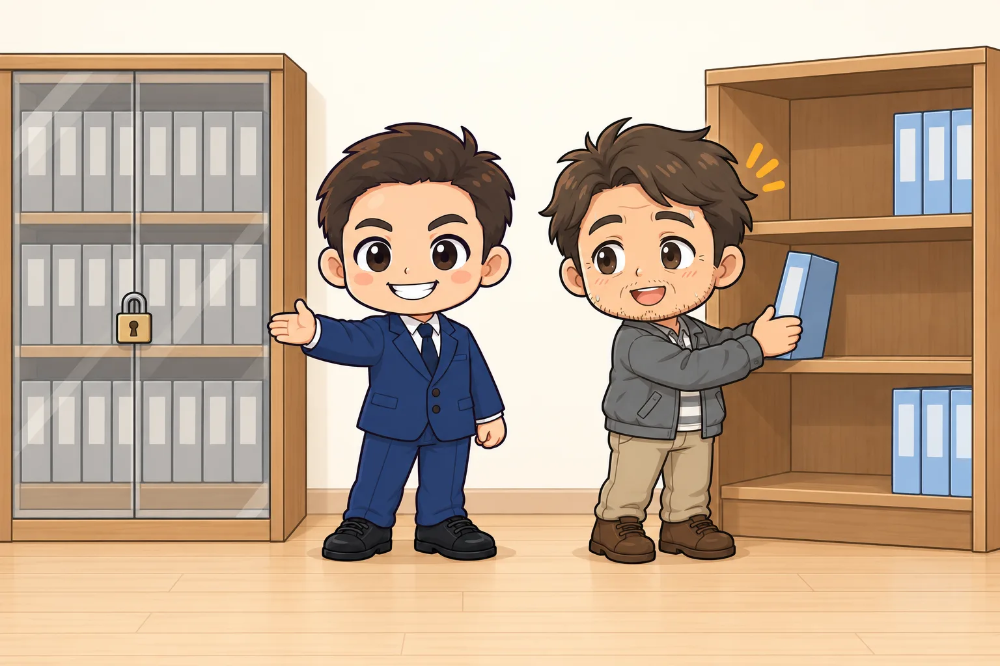

<!-- product-article-character-sheets: tamashiro-yusuke-character-sheet-v5.png, worried-business-owner-character-sheet-v1.png -->
<!-- product-article-character-check: hero-and-body-verified -->

[前の記事](/blog/onedrive-desktop-jc-agenda/)で、JCの議案はパソコンで作り、上程（理事会に議案を出すこと）が終わったらGoogleドライブに残す、と書きました。この記事はその続きです。

JCは毎年、委員会の顔ぶれが替わります。去年の同じ事業の議案を見たいのに、作った人のパソコンの中にしか無く、卒業した先輩に連絡して送ってもらう。そんな場面に心当たりのある方は多いと思います。

ここで書くのは、LOMで決まっているやり方ではありません。私が個人でやっていることをもとにした、提案です。

## 先に結論：年度ごとに共有ドライブを1つ作り、年度が終わったら見るだけにする

- 議案は今までどおりパソコンのExcelやWordで作り、アジェンダにはZIPで上げる
- 上程が終わったら、議案フォルダをまるごと「その年度の共有ドライブ」に上げる
- 委員長と副委員長はコンテンツ管理者、委員は投稿者にする
- 年度が終わったら、全員を閲覧者に替えて、次の年度の共有ドライブを作る

こうしておくと、前の年度の議案は誰にも消されずに残り、次の年度の担当がいつでも見に行けます。

## JCの議案は、なぜ次の年度に見つからないのか

担当が毎年替わるうえに、議案が作った人の持ち物になっているからです。

議案を作るのは、その年度の委員長や委員です。できあがった議案は、作った人のパソコンやメール、個人のクラウドに残ります。次の年度に同じ事業を担当した人は、まず「去年の議案はどこにありますか」と聞いて回ることになります。作った人が卒業していたり、パソコンを買い替えていたりすると、見つからないこともあります。

議案は、作った人の持ち物にせず、LOMの持ち物として残したい。私はそう考えています。

## 私がいまやっていること

いまの私のやり方は、次のとおりです。

- 議案はパソコンのExcelやWordで、Cドライブの中で作る
- 上程が終わったら、議案フォルダをGoogleドライブの共有ドライブに上げる
- 共有ドライブは、委員会ごとに1つ作っている
- 委員の方には、コンテンツ管理者として入ってもらっている

共有ドライブは、Google Workspace（会社や団体向けのGoogleの有料サービス）にある保管場所です。ここに置いたファイルは、上げた人ではなくチームの持ち物になります。私は、自分の会社で契約しているGoogle Workspaceを使っています。

この形には、直したいところが3つあります。委員会ごとに分けていること、委員の権限が強すぎること、置き場所が私の会社のアカウントであることです。ここからは、その3つを直した形を提案します。

## 提案1：共有ドライブは、委員会ごとより年度ごとに1つ

JCの委員会は、毎年組み替わります。名前が同じでも、委員長も委員も替わります。委員会ごとに共有ドライブを作ると、次の年度にその委員会が無くなったとき、ドライブの行き先に困ります。

そこで、年度ごとに1つ、共有ドライブを作るのがよいと考えています。

- 共有ドライブの名前：`2027年度 議案`
- 中のフォルダ：委員会ごと（`01_総務委員会`、`02_広報委員会`……）
- 委員会のフォルダの中：議案フォルダを、上程したときのまま入れる

年度ごとに分けておくと、年度が終わったときの片づけが「そのドライブの権限を替えるだけ」で済みます。やり方は、後の「年度の替わり目にやること」で説明します。

## 提案2：議案フォルダの名前は「日付_段階_事業名_議案の種類」

先に一つだけ注意があります。議案フォルダの**中のファイル名は、変えないでください**。予算書の見積書リンクは、フォルダの中のファイル名で記録されています。名前を変えると、リンクが切れます。

名前の決まりを付けるのは、議案フォルダの名前だけにします。私の案はこうです。

`2027-03-12_審議_4月例会_事業計画`

- 先頭に、上程した理事会の日付を入れる。並べたときに、日付の順になります
- 次に「協議」か「審議」を入れる。どの段階で上げた版かが分かります
- 最後に、事業名と議案の種類を入れる

協議と審議で中身が変わったときは、両方を残します。少なくとも、審議で承認された版と、事業報告の版は残してください。次の年度の担当がいちばん見たいのは、この2つだと思います。

## 提案3：委員は「投稿者」にして、消せる人をしぼる

共有ドライブでは、メンバーごとに権限を決めます。議案の保管で使うのは、次の4つです。

- 管理者：メンバーの追加や権限の変更ができる。ゴミ箱から完全に消すこともできる
- コンテンツ管理者：ファイルを足す・直すに加えて、動かす・ゴミ箱に入れる、ができる
- 投稿者：ファイルを足す・直すはできる。動かすこと、ゴミ箱に入れることはできない
- 閲覧者：見るだけ

ここに書いた権限の中身は、Googleの公式ヘルプ「[共有ドライブのファイルへのアクセスの仕組み](https://support.google.com/a/users/answer/12380484?hl=ja)」で確かめました（2026年10月16日）。

私の案は次のとおりです。

- 管理者：事務局長や専務理事など、年度をまたいで関わる人。1人だと抜けたときに困るので、2人以上にする
- コンテンツ管理者：委員長と副委員長
- 投稿者：委員

いま私の委員会では、委員の方もコンテンツ管理者です。この形だと、誰でもうっかりフォルダを動かしたり、ゴミ箱に入れたりできてしまいます。投稿者なら、議案を上げることはできても、ほかの人の議案を消すことはできません。間違った場所に上げたときは、委員長に動かしてもらいます。

投稿者にしておくと、もう一つよいことがあります。パソコン版Googleドライブ（パソコンのエクスプローラーにGoogleドライブを出すアプリ）では、投稿者はファイルを読むことしかできません。前の記事で書いた「クラウドとつながったフォルダで議案を作ってしまう」つまずきが、そもそも起きにくくなります。

## 上げ方：ブラウザで、議案フォルダをまるごと上げる

上程が終わったら、ブラウザでGoogleドライブ（drive.google.com）を開きます。

1. 左の「共有ドライブ」から、その年度の共有ドライブを開く
2. 自分の委員会のフォルダを開く
3. 左上の「新規」から「フォルダのアップロード」を選び、パソコンの議案フォルダを選ぶ

議案フォルダを、画面にドラッグして落としてもかまいません。

初めて上げる前に、Googleドライブの設定（drive.google.com/drive/settings）を一度だけ見てください。「アップロードしたファイルを Google ドキュメント エディタ形式に変換する」にチェックが入っていたら、外します。入ったままだと、ExcelやWordがGoogleの形式に変わり、見積書のリンクや様式が崩れることがあります。

## 前の年度の議案を、下書きに使うとき

去年の議案をもとに作るときは、ドライブの上では直しません。フォルダを右クリックして「ダウンロード」を選ぶと、ZIPにまとまって落ちてきます。

ZIPをCドライブで展開してから、Excelを開きます。議案フォルダの中の並びが上げたときのままなら、見積書のリンクもそのまま使えます。新しい見積書に差し替えたら、リンクを付け直してください。

## 年度の替わり目にやること

年度が替わるときに、管理者がやることは4つです。

1. 次の年度の共有ドライブ（`2028年度 議案`）を作り、委員会のフォルダを作る
2. 新しい年度の委員長と副委員長をコンテンツ管理者、委員を投稿者で入れる
3. 終わった年度の共有ドライブは、管理者以外の全員を閲覧者に替える
4. 新しい委員長に、前の年度の同じ事業の議案フォルダのリンクを送る。前の年度のメンバーでなかった人は、閲覧者で足す

閲覧者にしておけば、前の年度の議案は誰にも消されず、見ることはできます。次の年度の担当が、前の年度の議案をいつでも見に行ける。これが、年度をまたいで引き継ぐための、手間の少ない形だと思います。

## 議案を、誰のアカウントに置くか

ここは、言い切るのが難しいところです。

いちばん安心なのは、LOMがGoogle Workspaceを契約して、LOMの共有ドライブに置くことです。個人や個人の会社のアカウントに置くと、その人が卒業したときに、議案の行き場がなくなります。議案には会員の名前や連絡先が入ることもあるので、なおさらLOMの持ち物にしておきたいところです。

とはいえ、Workspaceを契約する予算が無いLOMも多いと思います。私のLOMも、今はそうです。

### 非営利団体向けの無料プランを調べてみる

Googleには、非営利団体向けの「Google for Nonprofits」という仕組みがあります。Googleの公式ヘルプの[参加資格](https://support.google.com/nonprofits/answer/3215869?hl=ja)では、日本で対象になる団体として、一般社団法人と公益社団法人が挙がっています。

審査に通れば、「[Google Workspace for Nonprofits](https://www.google.com/intl/ja/nonprofits/offerings/workspace/)」を1人あたり月0円で使えます。Googleの[比較表](https://knowledge.workspace.google.com/admin/billing/compare-google-workspace-features-for-nonprofits)では、この無料のプランでも共有ドライブを作れます（どれも2026年10月16日に確認）。

ただ、審査があるので、申し込めば必ず使えるとは限りません。条件は変わることもあるので、申し込む前に公式の案内を読んでください。

### それまでは、委員長のアカウントで始めてもよい

LOMの契約がまだなら、私のように、委員長が自分の会社などのGoogle Workspaceで共有ドライブを作って始める方法もあります。

この形で始めるなら、年度末に議案をどう渡すかを、最初に決めておいてください。たとえば「年度末に委員会のフォルダをまるごとダウンロードして、次の委員長かLOMの保管場所へ渡す」という決め方です。決めないまま年度が終わると、議案はその人の会社のアカウントに残ったままになります。

## アジェンダには、今までどおりZIPで上げる

アジェンダシステムには、今までどおり議案フォルダをZIPにまとめて上げます。見積書のリンクに、Googleドライブの住所を貼ることはすすめません。

アジェンダで議案を見る人が、全員その共有ドライブに入っているとは限らないからです。前の記事では、OneDriveの住所でリンクが開かなくなる話を書きました。Googleドライブの住所でも、入っていない人には同じことが起きます。アジェンダの議案は、ZIPの中だけで開けるようにしておいてください。

## よくある質問

### 新しく入会した人にも、前の年度の議案を見せたいです

共有ドライブに1人ずつ足していくと、年度が増えるほど手間がかかります。Googleグループ（何人かをまとめて、1つの宛先として扱える仕組み）で「現役の会員」のグループを作り、そのグループを前の年度の共有ドライブに閲覧者で入れておきます。新しく入会した人は、グループに足すだけで前の年度の議案を見られます。

### 卒業した人は、どうしますか

次の年度の共有ドライブには入れません。終わった年度の共有ドライブからも、外しておくと安心です。議案に会員の連絡先などが入っていることがあるからです。

### 無料のGoogleアカウントでもできますか

無料のGoogleアカウントでもGoogleドライブは使えますが、共有ドライブはありません。マイドライブのフォルダは作った人の持ち物なので、その人が卒業すると、最初に書いた「見つからない」が起きます。

### パソコン版Googleドライブは、使わないほうがいいですか

保管した議案を見るのには便利です。気をつけたいのは、ドライブの中のファイルを直接開いたまま、新しい議案を作り始めることです。作るのはCドライブ、残すのはGoogleドライブ。この分け方は、前の記事と同じです。
