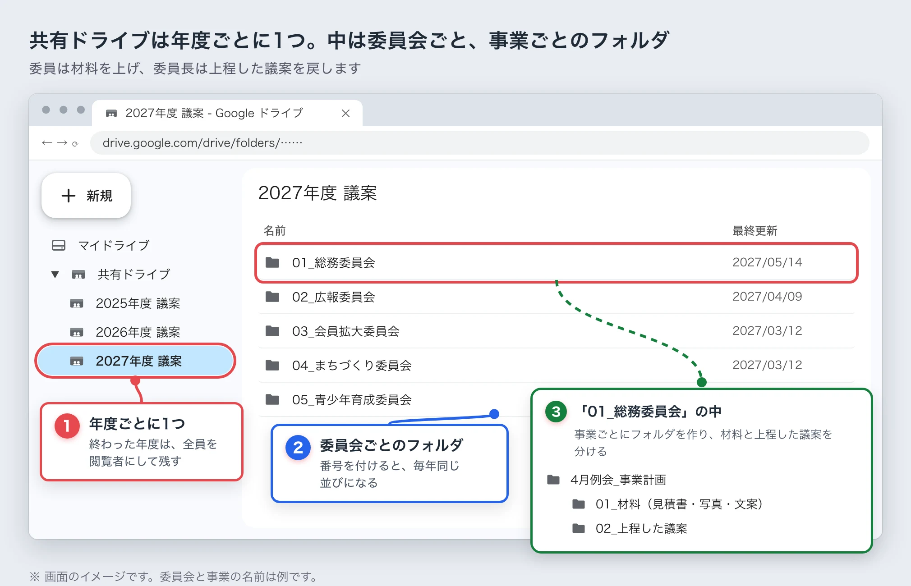
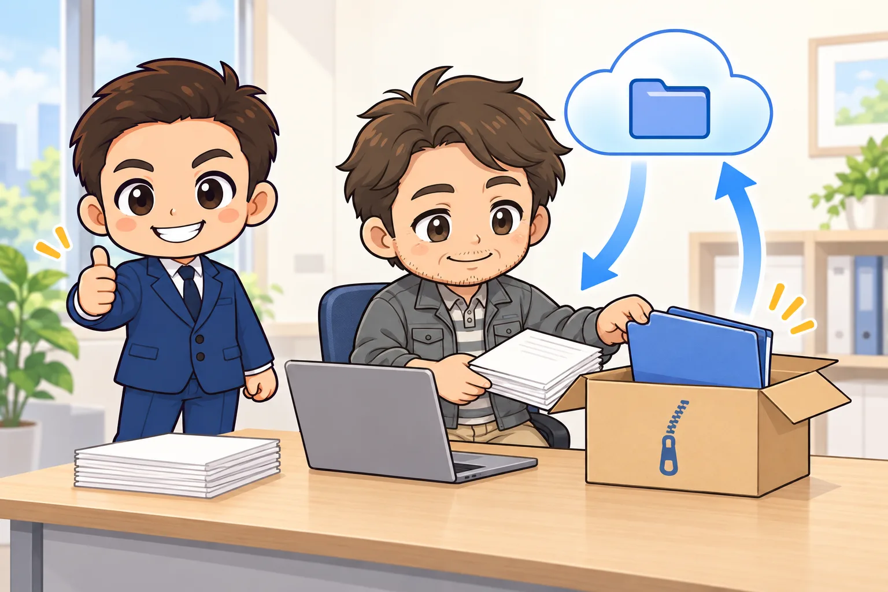
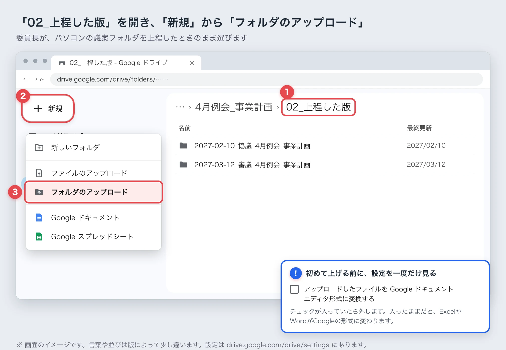

<!-- product-article-character-sheets: tamashiro-yusuke-character-sheet-v5.png, worried-business-owner-character-sheet-v1.png -->
<!-- product-article-character-check: hero-and-body-verified -->

[前の記事](/blog/onedrive-desktop-jc-agenda/)で、JCの議案はパソコンで作り、上程（理事会に議案を出すこと）が終わったらGoogleドライブに残す、と書きました。この記事はその続きです。

完成した議案は、アジェンダシステムにすべて上がっています。前の年度の議案も、見ようと思えばダウンロードして見られます。

困るのは、作っている途中です。予算書の見積書、事業の写真、事業計画の文案。委員会のメンバーがそれぞれ用意したものを、LINEやメールで送り合い、委員長が1つにまとめます。私も、委員長からLINEで議案のZIPを受け取っていました。

ここで書くのは、LOMで決まっているやり方ではありません。私が個人でやっていることをもとにした、提案です。便利なところと、どのLOMでも同じようにはいかない理由は、[3本目の記事](/blog/jc-gian-google-drive-proposal/)にまとめました。

## 先に結論：材料は共有ドライブに集め、組み立ては委員長のパソコンで

- 年度ごとに共有ドライブを1つ作り、中に委員会と事業のフォルダを作る
- 委員は、見積書や写真、文案を、事業のフォルダの「01_材料」に上げる
- 委員長は、材料をパソコンにダウンロードし、Cドライブで議案を組み立てる。リンクを付けてZIPにし、アジェンダに上げる
- 上程が終わったら、委員長がその議案フォルダを「02_上程した版」に上げる
- 委員長と副委員長はコンテンツ管理者、委員は投稿者にする

こうしておくと、LINEのトークをさかのぼってファイルを探さずに済みます。どれが最新の版かも、1か所を見れば分かります。

## LINEやメールで送り合うと、何が困るのか

ファイルが、送った人と受け取った人のトークの中に散らばってしまいます。

- 同じ見積書が何度も送られて、どれが最新か分からなくなる
- 写真や見積書が、委員それぞれのスマホやパソコンに分かれて残る
- 委員長がZIPにまとめて送り、受け取った人が展開して直し、またZIPにして送り返す
- LINEで送ったファイルは、保存できる期間が過ぎると開けなくなる

委員が増えるほど、やりとりの数も増えます。材料を1か所に集める場所があれば、このやりとりの多くは要らなくなります。

## 私がいまやっていること

いまの私のやり方は、次のとおりです。

- 議案はパソコンのExcelやWordで、Cドライブの中で作る
- 上程が終わったら、議案フォルダをGoogleドライブの共有ドライブに上げる
- 共有ドライブは、委員会ごとに1つ作っている
- 委員の方には、コンテンツ管理者として入ってもらっている

共有ドライブは、Google Workspace（会社や団体向けのGoogleの有料サービス）にある保管場所です。ここに置いたファイルは、上げた人ではなくチームの持ち物になります。私は、自分の会社で契約しているGoogle Workspaceを使っています。

この形には、直したいところが3つあります。上程した後にしか使っていないこと、委員の権限が強すぎること、委員会ごとに分けていることです。ここからは、作っている途中から共有ドライブを使う形を提案します。

## 共有ドライブは年度ごとに1つ。中は委員会ごと、事業ごと

JCの委員会は、毎年組み替わります。委員会ごとに共有ドライブを作ると、次の年度にその委員会が無くなったとき、行き先に困ります。そこで、年度ごとに1つ作り、中を委員会と事業のフォルダに分けます。

- 共有ドライブの名前：`2027年度 議案`
- 中のフォルダ：委員会ごと（`01_総務委員会`、`02_広報委員会`……）
- 委員会のフォルダの中：事業ごとのフォルダ（`4月例会_事業計画`）
- 事業のフォルダの中：`01_材料` と `02_上程した版`

「01_材料」は、委員が自由に足していく場所です。「02_上程した版」は、委員長が上程した議案フォルダを置く場所です。この2つを分けておくと、作りかけのファイルと、理事会に出した版が混ざりません。

## 権限：委員は「投稿者」にして、消せる人をしぼる

共有ドライブでは、メンバーごとに権限を決めます。使うのは、次の4つです。

- 管理者：メンバーの追加や権限の変更ができる。ゴミ箱から完全に消すこともできる
- コンテンツ管理者：ファイルを足す・直すに加えて、動かす・ゴミ箱に入れる、ができる
- 投稿者：ファイルを足す・直すはできる。動かすこと、ゴミ箱に入れることはできない
- 閲覧者：見るだけ

ここに書いた権限の中身は、Googleの公式ヘルプ「[共有ドライブのファイルへのアクセスの仕組み](https://support.google.com/a/users/answer/12380484?hl=ja)」で確かめました（2026年10月16日）。

私の案は次のとおりです。

- 管理者：事務局長や専務理事など、年度をまたいで関わる人。1人だと抜けたときに困るので、2人以上にする
- コンテンツ管理者：委員長と副委員長
- 投稿者：委員

投稿者でも、「01_材料」に見積書や写真を上げることはできます。ほかの人のファイルを動かしたり、ゴミ箱に入れたりはできません。うっかり消してしまう心配が減ります。

## 議案ができるまでの流れ

1. 委員長が、事業のフォルダと「01_材料」「02_上程した版」を作る
2. 委員は、用意した見積書や写真、文案を「01_材料」に上げる。パソコンならブラウザで開いてドラッグ、スマホならGoogleドライブのアプリから上げられる
3. 委員長は、「01_材料」を右クリックして「ダウンロード」を選ぶ。ZIPにまとまって落ちてくるので、Cドライブで展開する
4. 委員長は、Cドライブで議案フォルダを組み立てる。見積書を決まった場所に置き、Excelでリンクを付け、ZIPにしてアジェンダに上げる
5. 上程が終わったら、委員長が議案フォルダを「02_上程した版」にフォルダごと上げる

委員がやることは、材料を上げるところまでです。組み立てとアジェンダへの上げ下ろしは、今までどおり委員長が1人でやります。ここを分けておくと、誰がどの版を直しているのか分からなくなることがありません。

## 上程した版は、「日付_段階_事業名_議案の種類」の名前で残す

「02_上程した版」に上げる議案フォルダには、名前の決まりを付けます。私の案はこうです。

`2027-03-12_審議_4月例会_事業計画`

- 先頭に、上程した理事会の日付を入れる。並べたときに、日付の順になります
- 次に「協議」か「審議」を入れる。どの段階で上げた版かが分かります
- 最後に、事業名と議案の種類を入れる

協議と審議で中身が変わったときは、両方を残します。

一つだけ注意があります。議案フォルダの**中のファイル名は、変えないでください**。予算書の見積書リンクは、フォルダの中のファイル名で記録されています。名前を変えると、リンクが切れます。

上げるときは、ブラウザで「02_上程した版」を開き、左上の「新規」から「フォルダのアップロード」を選びます。議案フォルダを、画面にドラッグして落としてもかまいません。

初めて上げる前に、Googleドライブの設定（drive.google.com/drive/settings）を一度だけ見てください。「アップロードしたファイルを Google ドキュメント エディタ形式に変換する」にチェックが入っていたら、外します。入ったままだと、ExcelやWordがGoogleの形式に変わり、見積書のリンクや様式が崩れることがあります。

## 文案は、Googleドキュメントで一緒に書く

事業計画の目的や内容の文は、委員で何度も直します。Wordのファイルを送り合う代わりに、「01_材料」にGoogleドキュメント（ブラウザで書けるGoogleの文書）を1つ作り、同じ文書をみんなで直す方法があります。誰がどこを直したかは、変更履歴で後から見られます。

Googleドキュメントは、フォルダごとダウンロードすると、Wordの形式に変わって落ちてきます。委員長は、それを開いて議案のWordやExcelへ文を写します。

私はまだ、このやり方で議案の文を書いたことはありません。試すなら、文の量が多い事業計画から始めるのがよいと思います。

## 共有ドライブの中で、議案を組み立てない

組み立ては、必ずCドライブに落としてからにしてください。

パソコン版Googleドライブ（パソコンのエクスプローラーにGoogleドライブを出すアプリ）を使うと、共有ドライブの中のExcelを直接開けます。ただ、そこで見積書のリンクを付けたとき、リンクがどう記録されるかを、私はまだ確かめていません。前の記事のOneDriveのように、作った人のパソコンでしか開けないリンクになるおそれがあります。

委員を投稿者にしておくと、パソコン版Googleドライブでは、投稿者はファイルを読むことしかできません。委員が共有ドライブの中で議案を作り始めてしまうことも、起きにくくなります。

## アジェンダには、今までどおりZIPで上げる

アジェンダシステムには、今までどおり議案フォルダをZIPにまとめて上げます。見積書のリンクに、Googleドライブの住所を貼ることはすすめません。

アジェンダで議案を見る人が、全員その共有ドライブに入っているとは限らないからです。Googleドライブの住所は、入っていない人には開けません。アジェンダの議案は、ZIPの中だけで開けるようにしておいてください。

## 年度が終わったら

完成した議案はアジェンダに残るので、年度が終わってもやることは多くありません。

- 終わった年度の共有ドライブは、管理者以外の全員を閲覧者に替える
- 次の年度の共有ドライブを作り、新しい委員長と副委員長、委員を入れる

閲覧者にしておけば、アジェンダに上げなかった写真や文案も、消されずに残ります。次の年度に同じ事業を担当する人が、参考に見に行くこともできます。

## 議案を、誰のアカウントに置くか

ここは、言い切るのが難しいところです。

いちばん安心なのは、LOMがGoogle Workspaceを契約して、LOMの共有ドライブに置くことです。個人や個人の会社のアカウントに置くと、その人が卒業したときに、ファイルの行き場がなくなります。議案には会員の名前や連絡先が入ることもあるので、なおさらLOMの持ち物にしておきたいところです。

とはいえ、Workspaceを契約する予算が無いLOMも多いと思います。私のLOMも、今はそうです。

### 非営利団体向けの無料プランを調べてみる

Googleには、非営利団体向けの「Google for Nonprofits」という仕組みがあります。Googleの公式ヘルプの[参加資格](https://support.google.com/nonprofits/answer/3215869?hl=ja)では、日本で対象になる団体として、一般社団法人と公益社団法人が挙がっています。

審査に通れば、「[Google Workspace for Nonprofits](https://www.google.com/intl/ja/nonprofits/offerings/workspace/)」を1人あたり月0円で使えます。Googleの[比較表](https://knowledge.workspace.google.com/admin/billing/compare-google-workspace-features-for-nonprofits)では、この無料のプランでも共有ドライブを作れます（どれも2026年10月16日に確認）。

ただ、審査があるので、申し込めば必ず使えるとは限りません。条件は変わることもあるので、申し込む前に公式の案内を読んでください。

### それまでは、委員長のアカウントで始めてもよい

LOMの契約がまだなら、私のように、委員長が自分の会社などのGoogle Workspaceで共有ドライブを作って始める方法もあります。

この形で始めるなら、年度末にファイルをどう渡すかを、最初に決めておいてください。たとえば「年度末に委員会のフォルダをまるごとダウンロードして、次の委員長かLOMの保管場所へ渡す」という決め方です。決めないまま年度が終わると、ファイルはその人の会社のアカウントに残ったままになります。

## よくある質問

### 委員が、会社のGoogleアカウントを持っていません

Gmailのアカウントでも、共有ドライブのメンバーに入れられることがあります。ただ、会社などのGoogle Workspaceで作った共有ドライブの場合、そのWorkspaceの管理者が、外の人との共有を許している必要があります。

### 卒業した人は、どうしますか

次の年度の共有ドライブには入れません。終わった年度の共有ドライブからも、外しておくと安心です。議案に会員の連絡先などが入っていることがあるからです。

### 無料のGoogleアカウントでもできますか

無料のGoogleアカウントでもGoogleドライブは使えますが、共有ドライブは作れません。マイドライブ（自分だけの保管場所）のフォルダは作った人の持ち物なので、その人が卒業すると、ファイルの行き場がなくなります。

### 前の年度の議案を、下書きに使いたいです

完成した議案なら、アジェンダからダウンロードできます。共有ドライブの「02_上程した版」から使うときは、フォルダを右クリックして「ダウンロード」を選び、Cドライブで展開してから開いてください。議案フォルダの中の並びが上げたときのままなら、見積書のリンクもそのまま使えます。
