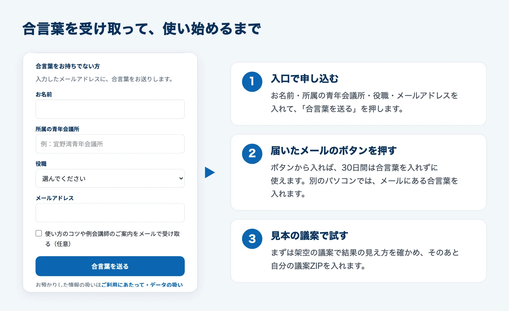
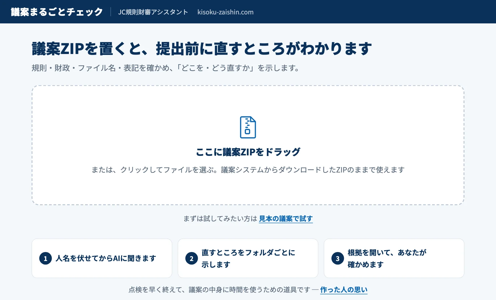
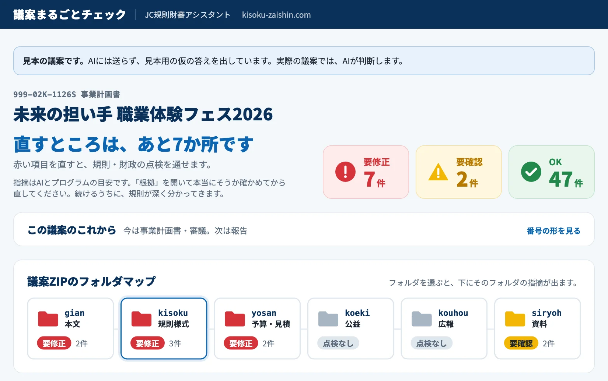
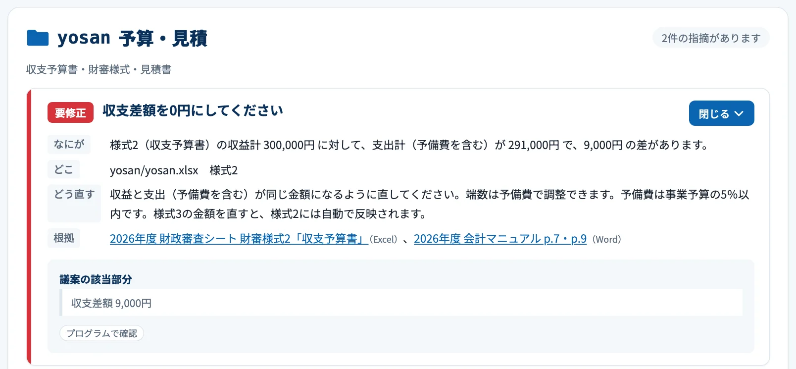
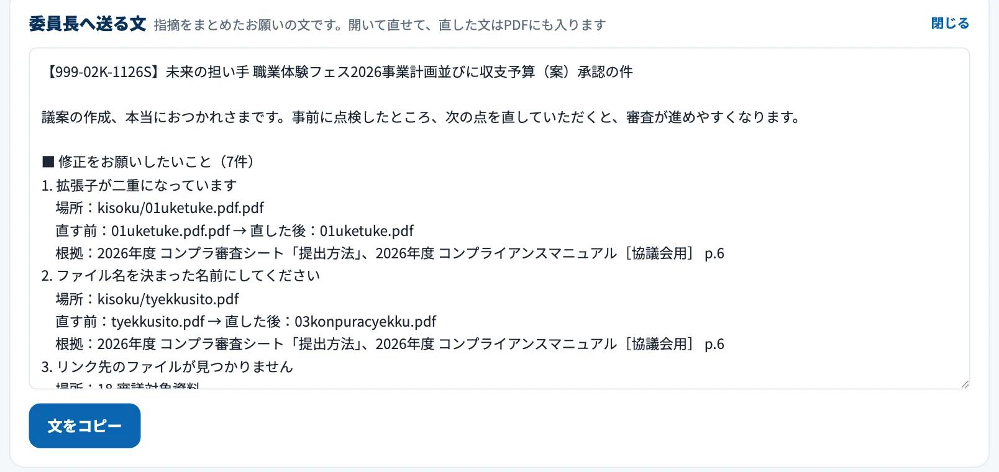
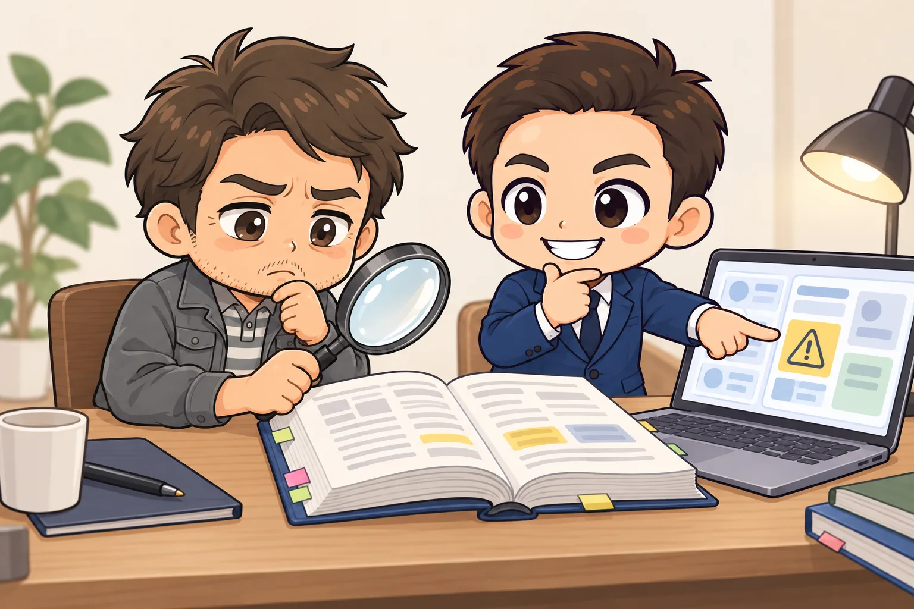

<!-- product-article-character-sheets: tamashiro-yusuke-character-sheet-v5.png, worried-business-owner-character-sheet-v1.png -->
<!-- product-article-character-check: hero-and-body-verified -->

JCの議案を出す前は、ファイル名、様式のそろい方、収支予算書の合計、見積書の宛名と、見直すところがたくさんあります。見落としがあると、規則財政審査会議で指摘されて、直して出し直すことになります。

この見直しを手伝う道具として、「[議案まるごとチェック](https://kisoku-zaishin.com/check/)」を作りました。議案ZIP（アジェンダシステムからダウンロードできる、議案一式をまとめたファイル）を入れるだけで、直すところを一覧で示します。無料で、合言葉をメールで受け取れば、JCメンバーなら役職に関係なく誰でも使えます。

## 先に結論：議案を出す前の「見直し」を早く終わらせる道具です

議案まるごとチェックがやることは、次の3つです。

- 議案ZIPの中身を、規則・財政・ファイル名・表記の決まりで点検する
- 直すところを「なにが・どこ・どう直す・根拠」の形で示す
- 結果をPDFで保存でき、委員長へ送るお願いの文も作る

合否は出しません。結果は提出前の目安で、最後に判断するのは規則財政審査会議です。点検にかける時間を短くして、事業そのものを考える時間を増やしてほしいと思っています。

## 合言葉は、メールで申し込めばすぐ届く

使うには合言葉が要ります。合言葉を持っていない方は、入口の画面で申し込めます。お名前、所属の青年会議所、役職、メールアドレスを入れて「合言葉を送る」を押すと、合言葉の入ったメールが届きます。

届いたメールのボタンを押せば、30日間は合言葉を入れずに使えます。別のパソコンで使うときは、メールに書いてある合言葉を入口で入れます。

役職の欄には、理事長や委員長のほかに「委員・会員」もあります。規則審査や財政審査の担当でなくても、議案を作る人、議案を見る人なら誰でも申し込めます。

申し込んだときの名前や所属は、合言葉を届けるため、使っている人の数を知るためなどに使います。くわしくは「[ご利用にあたって・データの扱い](https://kisoku-zaishin.com/check/data)」に書いています。

## 使い方：ZIPを入れて、直すところを見る

### 1. 議案ZIPを入れる

入口を通ると、議案ZIPを入れる画面が出ます。アジェンダシステムからダウンロードしたZIPを、そのままドラッグするだけです。中を開いたり、ファイルを並べ替えたりする必要はありません。

いきなり自分の議案を入れるのが不安な方は、「見本の議案で試す」を押してください。架空の議案で、結果の画面がどう見えるかを確かめられます。この記事の画面も、その見本の議案で撮ったものです。

### 2. 直すところを、フォルダごとに見る

点検が終わると、上に「直すところは、あと7か所です」のような一言と、要修正・要確認・OKの件数が出ます。その下に、議案ZIPのフォルダが地図のように並びます。

本文（gian）、規則様式（kisoku）、予算・見積（yosan）、資料（siryoh）など、フォルダごとに赤・黄・灰色の印が付きます。赤は直す必要があるところ、黄は念のため確かめてほしいところ、灰色は点検するものが無かったフォルダです。どのフォルダから手を付ければよいかが、ひと目で分かります。

### 3. 「なにが・どこ・どう直す・根拠」を読む

フォルダを選ぶと、そのフォルダの指摘が出ます。1件ずつ、何が問題か、どのファイルのどこか、どう直せばよいか、どの資料に決まりがあるかが並びます。

見本の議案では、たとえば次のような点を見つけます。

- 収支予算書の収益と支出が合っていない
- 見積書の宛名が「日本JC」などの略称のままになっている
- ファイル名が決まった名前になっていない、拡張子が「.pdf.pdf」と2回付いている
- 本文のリンク先のファイルが、議案フォルダの中に無い
- 前回の会議で出た意見への対応が空欄になっている
- 本文と添付資料で、開始時刻がずれている

ファイル名や金額のように白黒をつけられるものは、プログラムが判定します。文章を読んで判断が要るものだけ、AIに「はい」か「いいえ」で答えさせます。画面に出る言葉は、すべて前もって用意した文です。AIが文章を書くことはありません。

### 4. PDFで保存し、委員長へ送る

結果の画面の下には「委員長へ送る文」があります。指摘をまとめたお願いの文で、画面の中で書き直せます。「文をコピー」を押せば、LINEやメールにそのまま貼れます。

「結果をPDFで保存」を押すと、全部の指摘とこの文が入ったPDFが手元に残ります。議案を直したら、もう一度ZIPを入れて点検してください。

## 議案は預からない

議案には、人の名前や連絡先が入っています。そこで、議案の扱いには気を付けています。

- 議案ZIPは、使う人のパソコンのブラウザの中で開きます。制作者のサーバーには送りません
- AIに判断させるときは、名前を「人物A」のような記号に、電話番号やメールアドレスを伏せ字に置き換えてから、必要な部分だけを送ります。使っているAIは、TypeSafe AI社の「jev」（はい・いいえや選択肢だけを返すAI）です
- 点検の結果はどこにも残しません。残したいときは、自分でPDFに保存します

ただ、伏せ字はプログラムで行うので、書き方によっては名前を取りこぼすことがあります。外に出してはいけない情報がある議案は、その部分を消してから入れてください。

## 指摘が出たら、根拠を開いて確かめる

正直に言うと、この道具はまだ正確ではありません。指摘には必ず「根拠」として、コンプライアンスマニュアルや会計マニュアルのページを書いています。直す前に、そのページを開いて、本当にそう書いてあるかを見てください。

手間は増えます。それでも、根拠を開く作業を続けるうちに、日本青年会議所の規則が前よりもよく分かってくるはずです。私は、その手間も含めてこの道具を使ってほしいと思っています。

## この道具にこめた思い

### 規則財政審査の仕事は、いずれAIが担うようになる

私は2026年度、日本青年会議所 沖縄地区協議会で規則財政審査局長を務めています。AIが広がると「なくなる仕事」が話題になりますが、私が真っ先に思い浮かべたのは、自分のこの役職でした。

遅かれ早かれ、規則財政審査の仕事はAIが担うようになると思っています。それなら、審査する立場の私が、規則財政審査局の役割を自分の手で無くしにいこう。そう決めて、この道具を作りました。

この1年は「規則財政審査局をぶっ壊す」という目標を持って取り組んできました。言葉が強すぎるのは分かっています。本当にやりたいのは、壊したあとをちゃんと支えることです。

### 浮いた時間は、事業の中身へ

役職がなくなることを、怖がる必要はないと思っています。それよりも大きいのは、議案の見直しにかけていた時間を、事業の中身を考えることに使えるようになることです。

点検は早く終わらせて、どんな事業にするか、誰に届けるかを考える時間を増やしてほしい。審査する側も、指摘を書くことより、AIの答えの根拠を確かめることに時間を使うようになると考えています。

### AIは、速く走れるけれど行き先が分からない車

AIの使い方は、よく車の運転免許にたとえられます。いまは、使い方がよく分からないまま、スピードだけ出して走っている人が多いと私は見ています。

この道具で、自分の議案がいまどの段階にいて、あと何か所直せばよいかを早めにつかんでください。そして、AIの答えをそのまま使わずに根拠を確かめる習慣も、この道具から身につけてもらえたらうれしいです。

思いの全文は「[なぜ、この道具を作ったか](https://kisoku-zaishin.com/why.html)」に書いています。

## 合わない人・気を付けてほしいこと

- 公式の道具がほしい方：日本青年会議所・地区協議会・LOMの公式の道具ではありません。私が作り、無料で配っています
- 沖縄地区以外の方：点検のルールは、日本JCの2026年度のマニュアルと、沖縄地区の過去の議案をもとに作っています。地区ごとの決まりは点検できないことがあります
- 合否を知りたい方：合否は出しません。結果は目安で、最後の判断は規則財政審査会議と担当の部署です
- 手厚い問い合わせ対応がほしい方：無料・無保証で配っているので、個別のお返事や、機能を直す約束はできません。ご要望は問い合わせフォームで受け付けて、すべて目を通しています

## よくある質問

### お金はかかりますか

かかりません。無料で使えます。紹介ページには、開発者が所属する宜野湾青年会議所へのご支援の案内がありますが、任意です。支援してもしなくても、使える機能は変わりません。

### 規則審査や財政審査の担当でなくても使えますか

使えます。議案を作る人が、出す前に自分で点検するのが、いちばん効き目があると思います。委員が委員長に渡す前に点検する使い方もできます。

### 合言葉のメールが届かないときは

まず迷惑メールのフォルダを見てください。それでも見当たらないときは、入口の画面から、メールアドレスを確かめてもう一度申し込んでください。

### 使い方を動画で見られますか

[紹介ページ](https://kisoku-zaishin.com/)に、1分半ほどの使い方の動画があります。LOMの例会で使い方を実演してほしいときは、紹介ページの「例会導入を相談する」からご連絡ください。

## 議案まるごとチェックを使ってみる

- 使い始める：[議案まるごとチェック](https://kisoku-zaishin.com/check/)（入口で合言葉を申し込めます）
- 紹介ページと使い方の動画：[JC規則財審アシスタント](https://kisoku-zaishin.com/)
- 議案の扱いと利用条件：[ご利用にあたって・データの扱い](https://kisoku-zaishin.com/check/data)

この記事の画面と内容は、2026年10月17日時点のものです。

議案を出す前に一度入れてみて、見落としが見つかれば、それだけで審査の手戻りが1回減ります。浮いた時間で、事業をもう一段磨いてください。
