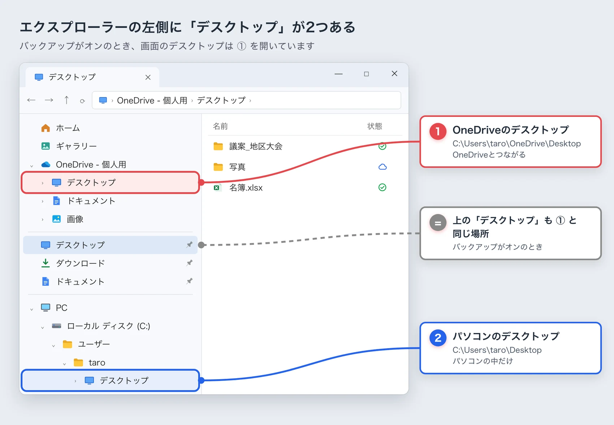
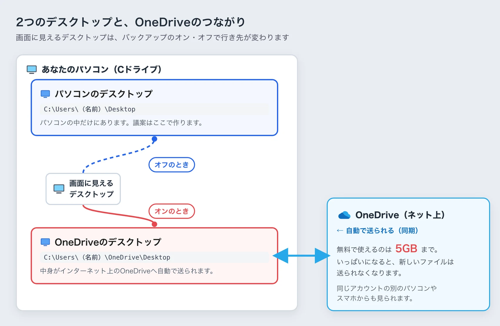
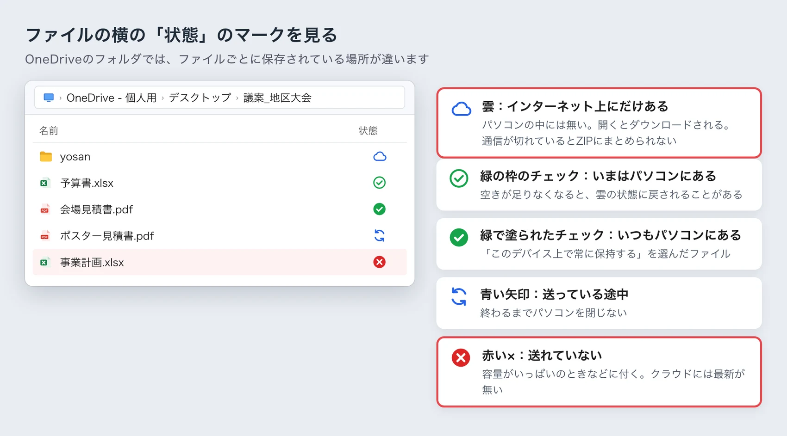
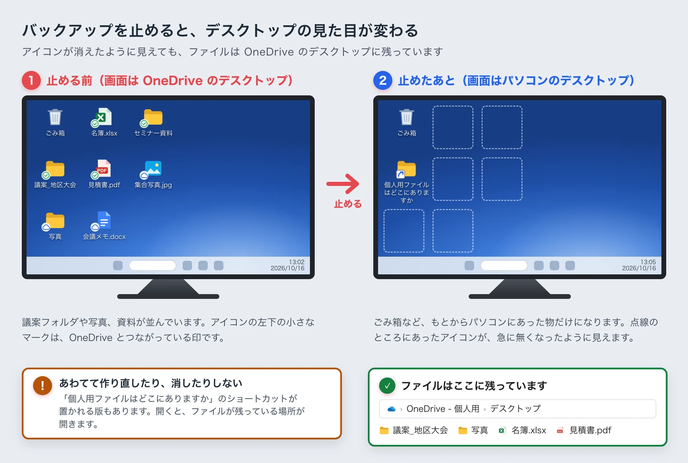
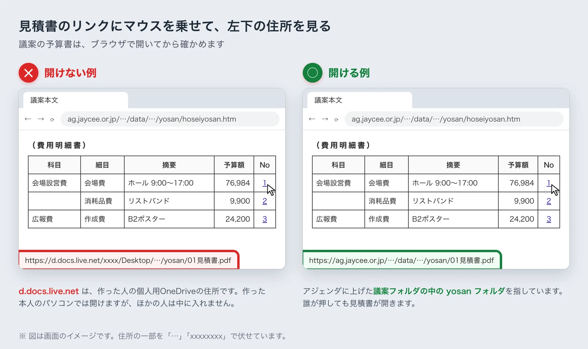
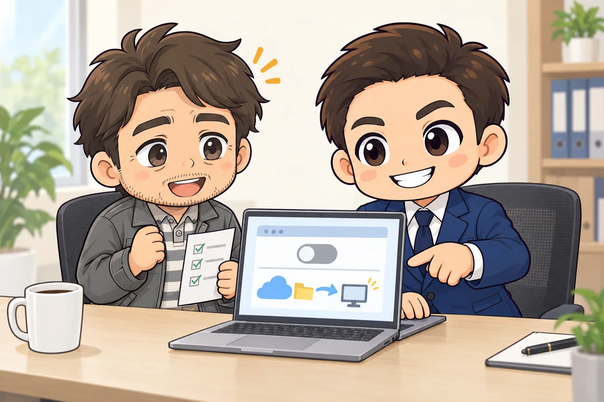
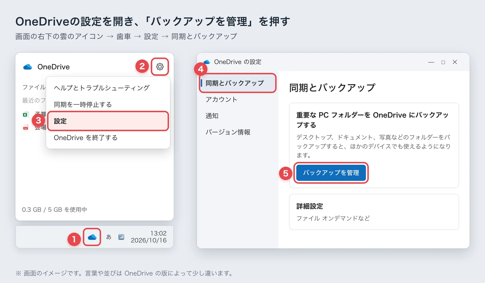
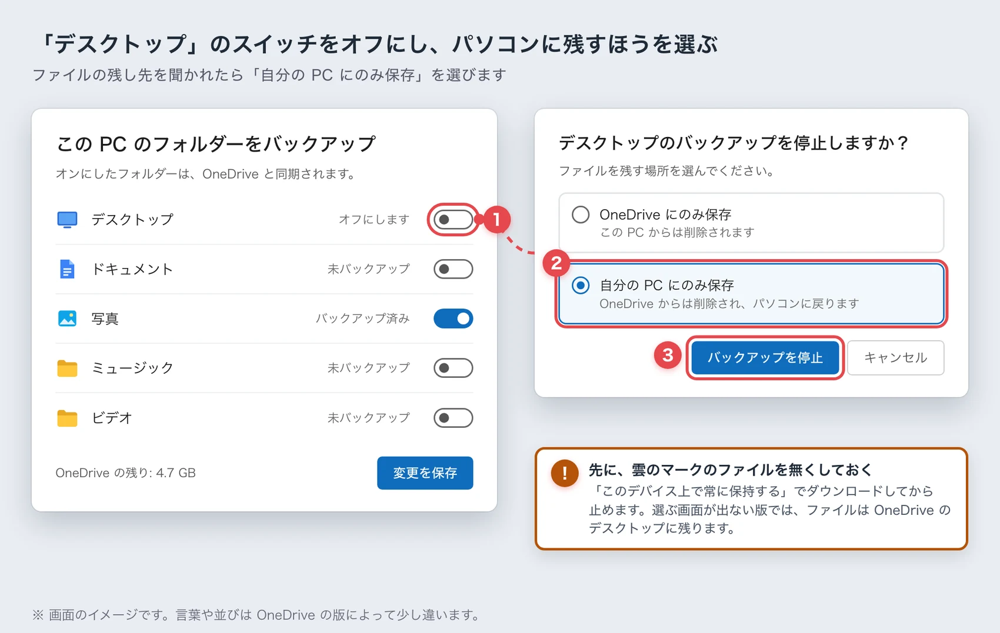
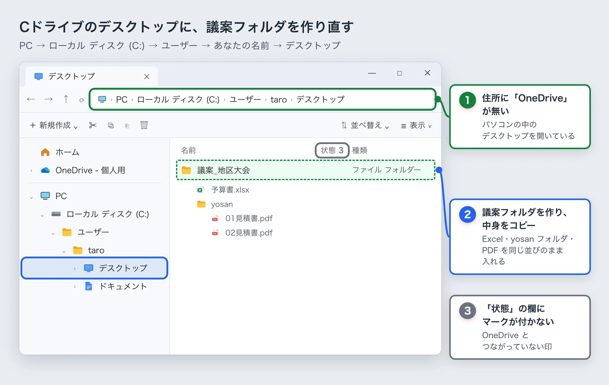

<!-- product-article-character-sheets: tamashiro-yusuke-character-sheet-v5.png, worried-business-owner-character-sheet-v1.png -->
<!-- product-article-character-check: hero-and-body-verified -->

アジェンダの議案を開いて、予算書の見積書リンクを押す。ところが、PDFが開かずにエラーになる。

アドレスを見ると、`https://d.docs.live.net/……/Desktop/……/yosan/01見積書.pdf` のような、見慣れない住所になっていました。

先日、JCの仲間からこの相談を受けました。議案を作った方に聞くと「最近パソコンを更新してから、こうなった」とのこと。原因はOneDrive（ワンドライブ。Windowsに最初から入っている、Microsoftのファイル保管サービス）の設定でした。

OneDriveは便利な道具です。ただ、仕組みが見えにくく、「ファイルが消えた」「どこに保存したか分からない」と困っている方は多いと感じています。この記事では、OneDriveでよく起きる混乱と、JCのアジェンダシステムで起きる困りごとを、画面の図を使って順番にほどいていきます。

## 先に結論：デスクトップのバックアップを止めて、Cドライブで作り直す

議案のリンクが開かない原因は、**議案フォルダが「OneDriveとつながったデスクトップ」に置かれていたこと**です。

Excelは、そのフォルダをパソコンの中の場所ではなく、インターネット上の住所として扱います。そのため、見積書へのリンクが「作った人のOneDriveの住所」で記録されます。作った本人以外は、その住所の中に入れません。

直し方は次の3つです。

1. OneDriveの設定で、デスクトップのバックアップを止める
2. Cドライブのデスクトップ（パソコンの中のデスクトップ）で、議案フォルダを作り直す
3. Excelでリンクを付け直し、ZIPにまとめて上げ直す

相談を受けた方も、この方法で直りました。ただし、バックアップを止めた直後に「デスクトップのアイコンの並びが急に変わった」とも言っていました。止める前にやっておくことがあるので、手順の章で説明します。

## Windowsには「デスクトップ」が2つある

混乱のいちばんの元は、Windowsのパソコンに、デスクトップと呼ばれる場所が2つあることです。

- **パソコンのデスクトップ**：`C:\Users\（あなたの名前）\Desktop` にある、もともとのデスクトップです。
- **OneDriveのデスクトップ**：`C:\Users\（あなたの名前）\OneDrive\Desktop` にある、OneDriveとつながったデスクトップです。

OneDriveのデスクトップのバックアップがオンになると、画面に見えているデスクトップの中身は、OneDriveのほうに切り替わります。見た目はいつものデスクトップのままなので、切り替わったことにまず気づきません。

エクスプローラー（フォルダを開く画面）の左側を見ると、「OneDrive - 個人用」の下と、「PC」の「ローカル ディスク (C:)」の奥の両方に「デスクトップ」があります。左の一覧の上のほうに出てくる「デスクトップ」は、バックアップがオンのときはOneDriveのほうを指しています。

OneDriveのデスクトップに置いたファイルは、インターネット上のMicrosoftの保管場所（クラウド）にも送られます。同じアカウントで入った別のパソコンやスマホからも見られるのが、よいところです。

## OneDriveでよくある混乱

### 知らないうちにバックアップがオンになっている

デスクトップ・ドキュメント・写真のバックアップは、Windowsの初期設定や更新のときに、オンにするよう案内されます。画面の案内に沿って「次へ」を押していくと、オンになっていることがよくあります。

今回の方も、自分でオンにした覚えはありませんでした。「更新したら変わった」という話は、このパターンが多いです。

### 無料の5GBは、すぐにいっぱいになる

無料で使えるOneDriveの容量は5GBです。デスクトップに写真や動画、仕事の資料を置いている方なら、すぐに超えます。

いっぱいになると、新しいファイルはクラウドへ送られなくなります。困るのは、パソコンの画面では今までどおり見えることです。クラウドに送られていないことに気づかないまま、使い続けてしまいます。

### 雲のマークのファイルは、パソコンの中に無い

OneDriveのフォルダでは、ファイル名の横に小さなマークが付きます。

雲のマークは「クラウドにだけあって、パソコンの中には無い」という意味です。ダブルクリックすればその場でダウンロードされて開けるので、ふだんは気になりません。

ところが、インターネットにつながっていないときや、フォルダごとZIPにまとめるとき、メールに添付するときに、このファイルが原因でうまくいかないことがあります。

### 止めたら、デスクトップのアイコンが消えたように見える

バックアップを止めると、画面のデスクトップはパソコンのほうへ戻ります。OneDriveのデスクトップに置いていたファイルは、止めるときの選び方によって、OneDriveのほうに残ることがあります。

すると、デスクトップから急にアイコンが無くなったように見えます。ファイルは消えたのではなく、もう1つのデスクトップに残っています。OneDriveの版によっては、「個人用ファイルはどこにありますか」という名前のショートカットが置かれます。開くと、OneDriveのほうのフォルダが開きます。

本当に削除してしまったときは、インターネット上のOneDrive（onedrive.live.com）の「ごみ箱」を見てください。個人用のアカウントなら、削除したファイルは30日のあいだ残っています。

## JCのアジェンダシステムで起きること

日本JCの議案は、Excelの様式で予算書や収支を作り、見積書などのPDFを添えて、フォルダごとZIPにまとめて上げます。予算書の見積書の欄から、PDFへリンクを張ります。

### 見積書のリンクが、作った人のOneDriveを指してしまう

議案フォルダがOneDriveのデスクトップにあると、Excelはリンクを `https://d.docs.live.net/（その人の番号）/Desktop/……` という住所で記録します。d.docs.live.net は、個人用OneDriveの住所です。

作った本人のパソコンでは開けるので、上げる前には気づきません。アジェンダに上がってから、審査する側や役員が押して初めて「開かない」と分かります。

議案フォルダがパソコンのデスクトップにあれば、リンクは「同じフォルダの中の yosan フォルダの、このPDF」という書き方で記録されます。ZIPのままアジェンダに上がるので、誰が押しても開けます。

### ZIPにまとめられない、中身が足りない

議案フォルダの中に雲のマークのファイルがあると、ZIPにまとめるときにダウンロードが走ります。容量がいっぱいで同期が止まっていたり、通信が切れたりすると、まとめられないか、ファイルが欠けたZIPになることがあります。

### 上げる前の見分け方

書き出した予算書のファイルをブラウザで開き、見積書のリンクにマウスを乗せてください。画面の左下に住所が出ます。

- `d.docs.live.net` や `onedrive` が入っていたら、作り直しが必要です。
- `……/yosan/01見積書.pdf` のように、議案フォルダの中を指していれば大丈夫です。

## 直し方：バックアップを止めて、Cドライブのデスクトップで作り直す

画面の名前は、OneDriveの版によって少し違います。似た名前のところを押してください。会社から渡されたパソコンで、OneDriveを会社が管理している場合は、自分で止めずに管理している人へ相談してください。

### 1. 止める前に、ファイルをすべてパソコンへ落としておく

エクスプローラーの左側で「OneDrive - 個人用」の中の「デスクトップ」を右クリックし、「このデバイス上で常に保持する」を選びます。雲のマークが、緑で塗られたチェックに変わるまで待ちます。

Microsoftの公式の案内（[OneDriveでフォルダーをバックアップする](https://support.microsoft.com/ja-jp/office/d61a7930-a6fb-4b95-b28a-6552e77c3057)・2026年10月16日に確認）でも、雲のマークのファイルが残っていると、止めるときに「移動できないファイルがある」と出ると書かれています。先にダウンロードしておけば、ファイルが消えたように見える混乱も防げます。

### 2. OneDriveの設定を開き、「バックアップを管理」を押す

画面の右下にある雲のアイコンを押し、歯車のマークから「設定」を開きます。左の「同期とバックアップ」を選び、「バックアップを管理」を押します。

### 3. 「デスクトップ」をオフにし、パソコンに残すほうを選ぶ

フォルダの一覧で、「デスクトップ」の右のスイッチをオフにします。ファイルをどちらに残すかを聞かれたら、「自分のPCにのみ保存」を選びます。デスクトップのファイルが、パソコンのデスクトップへ戻ります。

選ぶ画面が出ない版では、ファイルはOneDriveのデスクトップに残ります。その場合は、次の手順でパソコンのデスクトップへ移してください。アイコンの並びが変わるのは、画面のデスクトップがパソコンのほうに切り替わったためです。

### 4. Cドライブのデスクトップで、議案フォルダを作り直す

エクスプローラーの左側で「PC」→「ローカル ディスク (C:)」→「ユーザー」→「（あなたの名前）」→「デスクトップ」と開きます。ここに議案フォルダを作り、OneDriveのデスクトップにあった議案フォルダの中身をコピーします。

上のアドレス欄に `OneDrive` の文字が入っていないことを、必ず見てください。

### 5. Excelを開き直して、リンクを付け直す

コピーした議案フォルダの中のExcelを開き、見積書のリンクを付け直します。リンクの先は、同じ議案フォルダの中の yosan フォルダにあるPDFを選び直します。

保存して書き出したら、さきほどの「上げる前の見分け方」で左下の住所を確かめます。問題がなければZIPにまとめて、アジェンダに上げ直します。

## バックアップを止めたくない方へ

写真や家のファイルは、OneDriveに預けておきたい方もいると思います。その場合は、JCの議案だけをOneDriveの外で作る方法があります。

Cドライブのすぐ下に `C:\JC議案` のような作業用フォルダを作り、議案はいつもそこで作ります。OneDriveとつながっていない場所なので、リンクがOneDriveの住所になることはありません。

## 作業はパソコン、保管はGoogleドライブ

議案や写真をクラウド（インターネット上の保管場所）に残しておくことは、私も大事だと思っています。パソコンが壊れても、データが一緒に消えずに済むからです。

ただ、作っている途中の議案をクラウドとつながったフォルダに置くと、今回のようにリンクがおかしくなったり、ZIPにまとめられなかったりします。そこで私は、作る場所と残す場所を分けるやり方をすすめています。

- 作る：議案フォルダは、Cドライブのデスクトップや `C:\JC議案` で作る
- 残す：上程が終わった議案は、フォルダごとGoogleドライブに上げて保管する

Google Workspace（会社や団体向けのGoogleの有料サービス）には、「共有ドライブ」という保管場所があります。ここに置いたファイルは、チームの持ち物になります。LOMの役員が年度で替わっても前の年の議案がそのまま残るので、毎年担当が替わるJCには特に合っています。

Googleドライブにも、パソコンから使うアプリがあります。このアプリでクラウドのファイルを直接開いたまま議案を作ると、OneDriveと同じつまずきが起きることがあります。作るのはCドライブ、残すのはGoogleドライブ。この分け方は崩さないでください。

共有ドライブを年度ごとに分けて、次の年度へ議案を引き継ぐやり方は、続きの記事「[JCの議案は「年度ごとの共有ドライブ」へ](/blog/jc-gian-google-shared-drive/)」にまとめました。

Googleドライブに議案を残すこのやり方は、LOMや日本JCの決まりではなく、私が1人でやっていることです。便利なところと、まだ決まりにしにくい理由は、「[JCの議案をGoogleドライブで引き継ぐ案](/blog/jc-gian-google-drive-proposal/)」に書きました。

## よくある質問

### OneDriveを使うのは、やめたほうがいいですか

やめる必要はありません。パソコンが壊れたときの備えや、スマホとの共有には便利です。困るのは、知らないうちにデスクトップがOneDriveとつながり、容量やリンクの問題が起きることです。どこに保存しているかを自分で分かっていれば、上手に使えます。

### 有料プランにすれば、解決しますか

容量の問題は解決します。ただ、議案のリンクがOneDriveの住所になる問題は、容量とは関係なく起きます。議案は、OneDriveの外で作ってください。

### 止めたあと、ファイルが見つかりません

まず、エクスプローラーの「OneDrive - 個人用」の中の「デスクトップ」を見てください。止めるときの選び方によっては、そこに残っています。見つからないときは、インターネット上のOneDriveにサインインして、「ごみ箱」を見てください。

### 議案を受け取る側は、何かできますか

リンクの住所を書き換えても、作った人のOneDriveには入れません。アジェンダの「データ一括ダウンロード」でZIPを落とすと、見積書のPDF自体は入っていることがあります。いちばん早いのは、作った人に作り直してもらうことです。この記事を、そのまま送ってもらってもかまいません。
