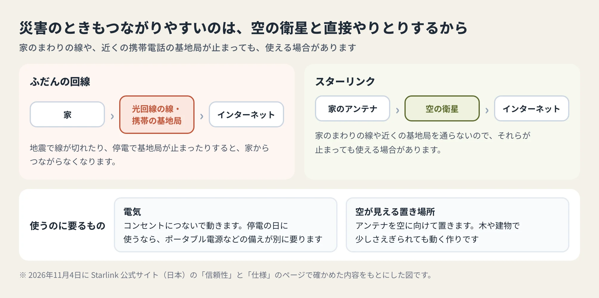

<!-- product-article-character-sheets: tamashiro-yusuke-character-sheet-v5.png, tl-four-character-style-master-v2.png, tamashiro-yusuke-business-casual-character-sheet-v3.png, rira-character-sheet-v3.png -->
<!-- product-article-character-check: hero-and-body-verified -->

スターリンク（Starlink）を申し込みました。

スターリンクは、空を回る人工衛星を使ったインターネットです。家の外に置いたアンテナが、衛星と直接やりとりします。公式サイトでは「プラグアンドプレイ」、つまりつなぐだけで使えると説明しています。

届いたら、設置から使い心地までをこのブログにまとめます。今回は届く前の記録として、申し込んだ時点で分かっていることを書いておきます。11月28日までのキャンペーンがあるので、気になっている方は早めに見てください。

  
  

    
Starlink公式サイト・紹介リンク

    <h3>紹介リンクで申し込むと7,000円</h3>
    
このリンクから公式サイトで申し込み、2か月使い続けると、申し込んだ方に7,000円の特典が付きます。キャンペーンは11月28日までです。

    <a class="affiliate-product-button" href="https://starlink.com?referral=RC-DF-16541981-74598-14" target="_blank" rel="sponsored noopener noreferrer">紹介リンクで公式サイトを開く</a>
    
広告・紹介リンクです。このリンクから申し込むと、玉城祐輔個人にも同じ金額の特典が入ります。料金やキャンペーンの内容は、公式サイトの注文画面でご確認ください。

  

## 先に結論：申し込むなら11月28日まで

2026年11月4日に公式サイトで確かめた内容をまとめると、次のとおりです。

- アンテナなどの機器と、月々のプランが50%オフになるキャンペーンが、11月28日で終わる
- 自宅向けの「ホーム」は月3,550円、外出先向けの「ROAM（ローム）」は月3,460円と表示されている（一部の地域）
- 紹介リンクから申し込み、2か月使い続けると、申し込んだ人と紹介した人の両方に7,000円が付く
- 30日間のお試しがあり、満足できなければ全額返金される

一方で、割引の料金がずっと続くわけではありません。どのくらいの期間続くかは、申し込むときの注文画面で確かめる必要があります。ここは後でくわしく書きます。

## スターリンクはどんなサービスか

スターリンクは、ロケットの会社として知られるSpaceX社の一部門が運営しています。公式サイトによると、160以上の国や地域で使われています。

日本の個人向けには、大きく分けて2つのプランがあります。

- **ホーム**：自宅で使うプラン。データは使い放題で、速度は最大400Mbps超
- **ROAM**：旅行やキャンプなど、出かけた先で使うプラン。かばんに入る小さなアンテナ「Starlink Mini」も選べる

公式サイトには「記載の速度は最大の速度で、保証ではなく、混雑時には遅くなる」という注意書きもあります。実際にどのくらい出るかは、届いてから自宅で測ってみます。

## 防災の面でも評価されている

スターリンクは、災害のときの通信手段としても使われています。

公式サイトには、日本向けに「災害時もつながるインターネット」というページがあります。台風や地震、大雪で光回線や携帯電話が使えなくなっても、つながりやすいと説明しています。最新のキットは、台風の豪雨の中でも接続を保ち、時速160km超の強風に耐え、マイナス40℃から43℃まで動く作りだと書かれています。

実際の災害でも使われました。KDDIの2024年1月12日の発表によると、能登半島地震では、石川県の珠洲市と輪島市にある災害医療チーム（DMAT）の本部に、スターリンクを50台届けています。ほかにも自衛隊や自治体、電力会社、避難所などに届け、合わせて約750台を支援に使ったとしています。発表では、アンテナが小さく軽くて運びやすく、短い時間で設置してWi-Fiを使えるようにできる点も説明しています。

防災の訓練にも取り入れられています。総務省の関東総合通信局は2024年5月、神奈川県の水防演習の会場で、スターリンクの回線を使ってFMラジオの番組をインターネットで流す訓練を、全国で初めて行いました。能登半島地震で、山の陰など災害用のラジオの電波が届かない地区があったことを受けた取り組みです。

公式サイトには、利用者の声も載っています。高知県の方は、台風で停電し携帯電話のデータ通信も使えなくなったときに、家族へメッセージを送れたそうです。沖縄県の方は、台風のあとに前のプロバイダーの回線が1か月ほどつながらず、スターリンクを入れたと話しています。

ただし、スターリンクは電気がないと動きません。家庭用のキットにはACケーブルと電源装置が入っていて、コンセントにつないで使います。停電の日にも使いたいなら、ポータブル電源（持ち運べる大きな充電池）など、電気の備えを別に考えておく必要があります。

## 11月28日までのキャンペーン

公式サイトの日本向けのページでは、「Starlinkハードウェアとサービスプランの50%オフ（自宅および旅行用）オファーは11月28日で終了」と案内しています。ハードウェアは、アンテナやルーター（家の中にWi-Fiを飛ばす機械）などの機器のことです。

気をつけたいのは、割引の料金が続く期間です。ネットでは「ずっと半額」と紹介している記事も見かけますが、公式ヘルプの「プロモーションサービス料金利用規約」には、割引の料金は「6か月間または12か月間など」の決まった期間だけで、その後は通常の料金になると書かれています。今回の割引が何か月続くのかは、注文画面に出る表示で確かめてください。

同じ規約には、次のことも書かれています。

- 最低利用期間（解約できない期間）はない
- 対象は新しく申し込む人だけで、割引は1回線分だけ
- プランを変えたり、一時停止や解約をしたりすると、割引はなくなる

## 紹介リンクを使うと、7,000円がもらえる

スターリンクには、すでに使っている人が友だちを紹介する仕組みがあります。公式サイトの紹介リンクのページには「このコードでサインアップすると￥7,000（現金またはStarlinkサービスクレジット）がもらえます」と出ます。サービスクレジットは、次の請求から差し引かれる割引のことです。

公式ヘルプ「Starlinkには紹介プログラムがありますか？」で、特典の条件を確かめました。

- starlink.com で、紹介リンクを使って申し込む
- 初月分を払い、届いたアンテナを使える状態にする（アクティベートと呼びます）
- 対象は新しく申し込む人だけ。前に契約していた人は対象外
- 対象のプランはホームとROAMの各プラン
- 特典は、使い始めてから60日たったあとに出る

注意したいのは、紹介リンクを使わずに注文すると、あとから紹介を付けられないことです。家電量販店などの販売店でキットを買った場合も対象外になります。

私の紹介リンクは次のとおりです。このリンクから申し込むと、申し込んだ方と私の両方に同じ金額の特典が付きます。

  
  

    
Starlink公式サイト・紹介リンク

    <h3>玉城祐輔の紹介リンク</h3>
    
開くと、公式サイトの上のほうに紹介コードが使われたことの案内が出ます。住所を入れると、その場所で使えるか、いくらになるかが分かります。

    <a class="affiliate-product-button" href="https://starlink.com?referral=RC-DF-16541981-74598-14" target="_blank" rel="sponsored noopener noreferrer">紹介リンクで公式サイトを開く</a>
    
広告・紹介リンクです。このリンクから申し込むと、玉城祐輔個人にも同じ金額の特典が入ります。料金やキャンペーンの内容は、公式サイトの注文画面でご確認ください。

  

## 申し込む前に見ておきたいこと

申し込む前に、次の4つを見ておくと安心です。

1. **住所で使えるかどうか。** 公式サイトの最初の画面で住所を入れると、その場所で使えるか、料金がいくらかが表示されます。割引も「一部地域」と書かれているので、自分の住所で見てみてください
2. **アンテナを置く場所。** アンテナは衛星とやりとりするので、屋根やベランダなど、置き場所を先に考えておきます。設置の決まりは、公式ヘルプの「セットアップと設置」にまとまっています
3. **割引が続く期間。** 注文画面で、何か月割引になるかを見ておきます。期間が終わると通常の料金に戻ります
4. **合わなかったときの戻り方。** 公式サイトには「30日間お試しください。ご満足いただけなかった場合は全額返金」とあります。返金の細かい条件も、申し込むときに読んでおきます

## 届いたらまとめること

届いたら、次のことを書く予定です。

- 申し込んでから届くまでの日数と、箱の中身
- 設置にかかった時間と、つまずいたところ
- 時間帯ごとの速さ（朝・昼・夜）
- 雨の日や風の強い日に、つながり方が変わるか
- 停電のときに、何の電気で動かせるか
- 毎月いくら払うことになったか

同じように迷っている方の参考になるよう、良かったところも困ったところも書きます。

## よくある質問

### キャンペーンはいつまでですか？

公式サイトでは、50%オフのオファーは11月28日で終わると案内しています（2026年11月4日に確認）。表示されている料金の横には「11/29まで有効」ともあります。迷っている方は、28日までに申し込むと確実です。

### 割引の料金はずっと続きますか？

公式の規約では、割引の料金は「6か月間または12か月間など」の決まった期間だけで、その後は通常の料金になります。今回の期間は、注文画面で確かめてください。

### 紹介の7,000円はいつもらえますか？

使い始めてから60日たったあとに出ます。最初はサービスクレジットとして次の請求から差し引かれる設定で、現金で受け取りたい場合は、starlink.com の紹介の画面で切り替えます。

### 停電のときも使えますか？

電気があれば使えます。家庭用のキットはコンセントにつないで動くので、停電の日はポータブル電源などで電気をまかなう必要があります。持ち歩き向けの「Starlink Mini」は、DC電源（車のシガーソケットなどの直流の電気）でも動くと公式サイトで説明しています。

### 解約できない期間はありますか？

割引の料金の規約には「最低利用期間はありません」と書かれています。ただし、解約すると割引はなくなります。

## 公式情報

2026年11月4日に確かめました。料金やキャンペーンは変わることがあるので、申し込む前に公式サイトでご確認ください。

- [Starlink 公式サイト（日本）](https://starlink.com/jp)
- [Starlinkには紹介プログラムがありますか？（公式ヘルプ）](https://starlink.com/jp/support/article/eee7e99e-a736-f16e-9506-c446dd70fb16)
- [プロモーションサービス料金利用規約（公式ヘルプ）](https://starlink.com/jp/support/article/1c02f831-d9fa-3602-eb59-28af01fb470d)
- [Starlink 信頼性（災害時もつながるインターネット）](https://starlink.com/jp/reliability)
- [KDDIとDMAT、Starlinkで能登半島の災害医療現場を支援（KDDI・2024年1月12日）](https://newsroom.kddi.com/news/detail/kddi_pr-1090.html)
- [全国初 衛星インターネット機器（Starlink）を使用したFMラジオ放送の配信訓練を実施しました（総務省 関東総合通信局・2024年5月30日）](https://www.soumu.go.jp/soutsu/kanto/e-komfo/2024/0530ho.html)
