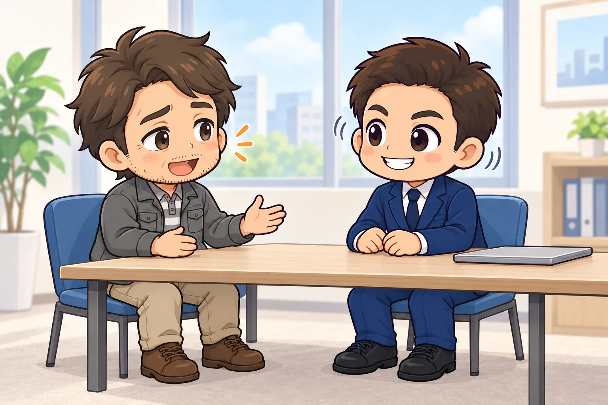

<!-- product-article-character-sheets: tamashiro-yusuke-character-sheet-v5.png, worried-business-owner-character-sheet-v1.png, tl-four-character-style-master-v2.png -->
<!-- product-article-character-check: hero-and-body-verified -->

人前で話すのは、私にとっても難しいことです。

日本人は、スピーチの練習をする機会がほとんどありません。人を引きつける話や、相手が「よし、やろう」と動きたくなる話は、なかなかできるものではないと思っていました。

2026年10月25日、青年会議所（JC。20〜40歳の経営者や会社員が、地域のための活動をする団体）の沖縄ブロックが開いた、表現力を磨く研修「The Voice」で学んできました。講師は、経営者や政治家、TEDに出る人のスピーチを支えてきた、話し方の指導の専門家です。

2時間半、ほとんど座らずに、立って、歩いて、話す研修でした。そこで分かったのは、伝える力は練習すれば伸びること、そしてテクニックがとても大事なことです。

この記事では、研修で学んだことのうち、明日からすぐ試せるものに絞ってまとめます。

## 先に結論：明日から試せる伝え方

- 聞くときは、いつもの3倍うなずく
- ほめられたら、「いえいえ」と返さずに受け取る
- 話す前に、深呼吸や肩回しで体をほぐす
- 足の先まで相手に向けて、腕は組まない
- 声は、ふだんを5として、強めるところは8〜9、小さくするところは2
- 「えー」でつながず、大事なひと言の前後で2〜3秒黙る

全部を一度にやらなくて大丈夫です。講師も最後に「1つだけでいいので、明日から変えるものを決めてください」と話していました。

## 思いは、伝わって初めて「ある」ことになる

研修の最初に講師が話したのは、どんなによい商品も、誰にも知らせなければ世の中に無いのと同じだ、ということでした。

思いや情熱も同じです。心の中でどれだけ大切に思っていても、相手に届かなければ、相手にとっては無いのと同じになります。「言わなくても分かってくれるだろう」は通じません。

もう1つ印象に残ったのが、AIの話です。きれいな文章は、AIでも作れるようになりました。人にしか出せないのは、自分の思いや、成功や失敗の話を、熱を込めて届けることです。研修の開会でも、委員長から「今日は上手に話そうとしなくていい。本気で伝えようとしてください」というお願いがありました。

## 聞くとき：リアクションは、いつもの3倍

研修のルールは「静かに聞くのは禁止。リアクションはいつもの3倍」でした。

講師は以前、どうしても教わりたい人の講演会に行き、一番前の真ん中に座って、会場の誰よりも大きくうなずいたそうです。講演者は、ほとんどの時間を講師のほうを見て話してくれました。それがきっかけで、その人に相談役になってもらえたそうです。

話し手は、よく反応してくれる人に向けて話したくなります。講師はこれを「与えがいのある人になる」と言っていました。

うなずくことは、自分のためにもなります。うなずくと、自分の頭に「これは大事な話だ」と伝わり、内容を覚えやすくなるそうです。

### ほめられたら、まず受け取る

ほめ言葉は、相手が気持ちを込めて渡してくれた贈り物です。

「いえいえ、大したことないです」と返すと、贈り物を押し返したことになります。相手は「この人はほめても受け取ってくれない」と感じて、次からほめなくなります。

まず「ありがとうございます。うれしいです」と受け取る。謙虚な気持ちは、そのあとに「もっと頑張ります」と言えば十分に伝わります。

## 話す前：体を動かすと、言葉が出てくる

緊張すると、体が固まり、息が浅くなります。頭に回る酸素が減るので、話すことを忘れたり、表現が小さくなったりします。

講師は、人前で話す前に必ず体を動かすそうです。研修でも、座ったままの最初より、会場を歩き回ったあとのほうが、参加者の言葉がすらすら出ていました。

深呼吸、肩回し、少し歩く。会議の最初に30秒入れるだけでも、場の空気が変わります。

## 話すとき：言葉より、体と声が伝わる

### 人は、言葉より体を信じる

口では「聞いてるよ」と言いながら、目がパソコンに向いていたら、相手は聞いていないと受け取ります。言葉と体の動きがずれているとき、人は体のほうを信じます。

研修では、会場を歩く練習のあと、席に戻ってすぐパソコンを開いたテーブルだけ、会話が始まるのが遅かったそうです。会議が終わってすぐにパソコンを開くと、それだけで「話しかけないで」と伝わります。会議のあと2〜3分はパソコンを開かずにいると、部下から話しかけられることが増えるそうです。

### 足の先まで、相手に向ける

腕組みは、相手の話を受け付けない、心を閉じている、という合図に見えます。足の先が別の方向を向いているのは、「この場から離れたい」という合図です。

足は肩幅に開き、つま先まで相手に向ける。胸を張って、手のひらを見せるように手を開く。これだけで、心を開いて話している人に見えます。

### 声の大きさは、差をつける

声は楽器です。高い・低い、速い・遅い、大きい・小さいの使い分けで、伝わり方が変わります。

特に声の大きさは、思い切って差をつけます。ふだんの声を5とすると、5から6に上げても、聞き手はほとんど何も感じません。強めるところは8〜9、小さくするところは2。大げさなくらいの差をつけて、やっと変化が伝わります。

研修では、聞き手が指揮者になり、手の高さで話し手の声の大きさを操る練習もしました。

### 事実より、ストーリーを話す

事実を並べるだけでは、人の心は動きません。

前はどうだったか、何がきっかけだったか、そしてどう変わったか。その間の気持ちを入れて話すと、聞き手の心に残ります。

研修の1分スピーチでも、「青年会議所に入る前は、面倒なことはしたくなかった。被災地のための事業に関わり、誰のために、何のためにやるのかを考えるようになった。今は目的を持って動くようにしている」という話が、会場によく伝わっていました。

### 「えー」をやめて、黙る

講師は、黙ることが表現の中でいちばん強い技だと話していました。

間を空けずに話し続けると、聞き手は話を受け止めきれず、ほとんど頭に残りません。「えー」「あー」で間を埋めずに黙ると、聞き手はその間に考えたり、想像したりできます。

ほめるときも同じです。「よかったよ。ところでさ」とすぐ次の話に移らず、ほめたあとに少し間を置くと、ほめ言葉が相手にしみ込みます。

### 残るのは、ひと言だけ

講師によると、聞き手が覚えているのは、話した中身の1%ほどだそうです。

研修の公開コーチングのあと、聞いていた人が「話の中身はあまり覚えていない。でも、最後に声を大きくして言った『沖縄を変えていく』だけは覚えている」と話していました。

細かい説明を全部伝えようとしない。一番伝えたいひと言を決めて、そこで声と体をいちばん大きくします。

## リーダーへ：場の熱は、リーダーの熱で決まる

研修で、リーダーの立場の人に向けた話もありました。

メンバーは、リーダーより熱くはなりにくいものです。リーダーより目立つことは「自分のほうが上だ」という合図になってしまうので、人は自然とリーダーの熱の下にとどまります。リーダーの熱が、その場の上限になるということです。

講師は、先生が淡々と「ここ、試験に出るから」と言う場合と、熱を込めて言う場合を演じ分けてくれました。教室の反応はまるで違いました。

聞く側にもできることがあります。自分のリアクションで、場の熱を引き上げることはできます。

## 恥ずかしいくらいで、ちょうどいい

研修中、「恥ずかしい」「ばかっぽい」と感じた人は多かったと思います。講師は、そう思うのはかまわないけれど、それで動きを止めないこと、と話していました。

いつもの自分と違うと感じるくらい大げさにやって、やっと相手に伝わります。最初は演技でかまいません。人は料理も歩き方も、まねをしながら覚えてきました。何度もやるうちに、自分のものになります。

## 私が明日から試すこと

私がまず試したいと思ったのは、「えー」をやめて黙ることです。

私は、セミナーで話したり、商工会で事業者さんの相談に乗ったりする機会があります。大事なひと言の前とあとに、2〜3秒黙る。まずはこれ1つに決めて、続けてみます。

人前で話すのが苦手な人も、上の6つから1つだけ選んで、明日の会議や打ち合わせで試してみてください。
